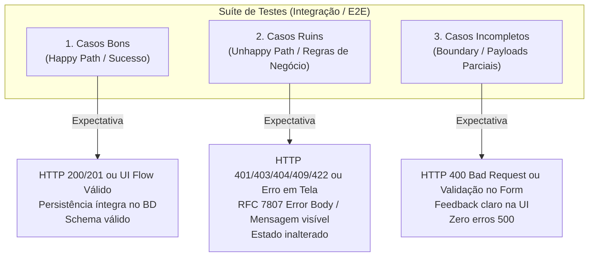

# ADR 0002: Padrão Tripartite de Cenários de Teste — Casos Bons, Casos Ruins e Casos Incompletos

## Status
Aceito (Accepted)

## Data
2026-09-23

## Contexto

Com a decisão estabelecida no [ADR 0001](0001-estrategia-de-testes-integracao-e-e2e.md) de focar exclusivamente em **Testes de Integração e E2E**, surge a necessidade crítica de definir a profundidade e a taxonomia dos cenários que devem compor cada suíte de testes.

Um dos erros mais frequentes na engenharia de software é a cobertura assimétrica: desenvolvedores tendem a cobrir quase que exclusivamente o "caminho feliz" (*happy path*), negligenciando erros de domínio e falhas de validação de borda. No contexto do sistema de gestão de estandes e eventos:
- Falhas em **casos de negócio (ruins)** geram conflitos graves na operação do evento (ex: expositor visualizando taxas antes da planta ser aprovada; reprovação de planta que já possui pagamento gerado; expositor acessando ou alterando projetos de terceiros; duplicidade de CNPJ/CPF ou de nome de taxa ativa).
- Falhas em **casos incompletos ou malformados** causam falhas catastróficas não tratadas (*500 Internal Server Error*), derrubam instâncias em produção ou corrompem o banco com registros inconsistentes.

Portanto, é mandatório formalizar um padrão de cobertura que guie engenheiros e agentes autônomos de IA em cada ciclo de desenvolvimento.

---

## Decisão

Instituímos o **Padrão Tripartite de Cobertura de Testes**. Toda funcionalidade, rota da API e fluxo de negócio deve possuir suítes de teste divididas obrigatoriamente em três categorias canônicas, tanto nos **Testes de Integração (Backend)** quanto nos **Testes End-to-End (E2E / Frontend)**:



> **Aplicação em Testes E2E (Frontend):**  
> Os testes E2E (Cypress) devem validar não apenas o fluxo de sucesso, mas também que respostas de erro (4xx) e entradas inválidas gerem mensagens compreensíveis na interface do usuário (ex.: alertas, validações de campos e estados desabilitados). Além disso, os testes E2E devem ser executados em resoluções desktop (ex.: `macbook-15`) e mobile (ex.: `iphone-x`), assegurando usabilidade e acessibilidade de componentes interativos.

---

### Categoria 1: Casos Bons (Happy Path / Sucesso)

- **Objetivo**: Validar que, sob condições ideais e com todos os dados obrigatórios e opcionais válidos, o sistema processa a operação com êxito e cumpre seu propósito de negócio.
- **Critérios de Validação**:
  - Respostas HTTP com códigos semânticos de sucesso: `200 OK`, `201 Created` ou `204 No Content`.
  - Corpo da resposta condizente com o contrato da API (JSON schema validado).
  - Persistência efetiva verificada diretamente no banco de dados (ex: registro gravado com chave estrangeira correta, data de criação e status inicial esperado).
  - Emissão de eventos de histórico (`ProjectHistoryEvent`) e notificações colaterais esperadas.
- **Exemplos no SI600 Web Eventos**:
  - Cadastro de novo `Projeto` expositor com taxas vinculadas (`ProjectFee`) e status inicial `AGUARDANDO_PDF`.
  - Upload de `Planta` em PDF válido pelo `Cliente` e aprovação pelo `Administrador` confirmando `approvedAreaM2`.
  - Preenchimento de quantidade em taxa `VARIAVEL` (`AGUARDANDO_COTACAO`) seguido de cotação pelo `Administrador` (`COTADA`).

---

### Categoria 2: Casos Ruins (Unhappy Path / Regras de Negócio & Falhas Operacionais)

- **Objetivo**: Validar que o sistema é resiliente e impede proativamente violações de regras de domínio, estados ilegais, conflitos de estado e acessos não autorizados.
- **Critérios de Validação**:
  - Respostas HTTP semânticas específicas de erro de cliente:
    - `401 Unauthorized`: Requisição sem cabeçalhos de identidade válidos.
    - `403 Forbidden`: `Cliente` autenticado tentando consultar, enviar PDF ou alterar quantidades de um `Projeto` pertencente a outro `ownerId`, ou tentando acionar rotas exclusivas de `ADMIN`.
    - `404 Not Found`: Referência a recurso inexistente (`projectId`, `feeId` ou `projectFeeId` inválido).
    - `409 Conflict`: Conflito de integridade ou máquina de estados (ex: `Cliente` consultando taxas antes da planta estar `APROVADO`; reprovação de planta que já possui `PAGAMENTO_GERADO`; cadastro de projeto com CPF/CNPJ ou e-mail duplicado).
    - `422 Unprocessable Entity`: Violação semântica de regra de domínio (ex: `paymentDeadline` anterior a `pdfDeadline`).
  - **Idempotência de Falha**: O teste DEVE verificar no banco de dados que **nenhum estado foi corrompido ou gravado parcialmente** após o erro.
  - Resposta no formato padronizado **RFC 7807 (*Problem Details*)**, contendo `type`, `title`, `status`, `detail` e matriz `errors` quando aplicável.

---

### Categoria 3: Casos Incompletos (Boundary, Malformed & Partial Payloads)

- **Objetivo**: Assegurar que requisições incompletas, corrompidas ou que violem os limites de schema sejam barradas na camada de validação e não causem exceções não tratadas (*500 Internal Server Error*).
- **Critérios de Validação**:
  - Resposta HTTP `400 Bad Request` contendo a matriz detalhada de violações encontradas na validação.
  - **Cenários Mandatórios de Teste**:
    1. **Campos Obrigatórios Faltantes (*Missing Properties*)**: Envio de JSON omitindo campos mandatórios (ex: `POST /api/projects` sem `companyName` ou sem `feeIds`).
    2. **Valores Nulos e Vazios**: Envio de campos preenchidos com `null`, strings vazias `""` ou contendo apenas espaços em branco `"   "`.
    3. **Tipos e Formatos Incompatíveis**: Envio de strings não numéricas em `areaM2` ou arquivos sem assinatura binária `%PDF-`.
    4. **Limites de Borda (*Boundary Values*)**:
       - Metragens, quantidades ou valores de cotação negativos ou iguais a zero (`<= 0`).
       - Strings com caracteres excedendo o tamanho limite configurado.
       - Upload de PDF acima do limite de 10 MB (`413 Payload Too Large` / `400 Bad Request`).
    5. **Payload Totalmente Vazio**: Envio de `{}` no corpo da requisição.
  - **Proteção contra Vazamento de Informações**: Em nenhuma hipótese a resposta deve conter *stack traces* de runtime ou expor detalhes internos do banco de dados/framework.

---

## Convenções Estruturais de Código de Teste

### 1. Organização em Blocos (Integração Backend e E2E Frontend)

```java
@SpringBootTest
@AutoConfigureMockMvc
class ProjectFeeIntegrationTest {

    // 1. CASO BOM (Happy Path)
    @Test
    void deveCalcularTaxasQuandoPlantaEstiverAprovada() throws Exception {
        // Arrange: Cria projeto, envia PDF e aprova com areaM2 = 25.00
        // Act & Assert: GET /projects/{id}/fees retorna 200 OK com valores calculados
    }

    // 2. CASO RUIM (Sad Path / Regra de Negócio)
    @Test
    void deveRetornar409QuandoClienteConsultarTaxasAntesDaAprovacaoDoPdf() throws Exception {
        // Arrange: Projeto em AGUARDANDO_PDF ou PDF_EM_ANALISE
        // Act & Assert: GET /projects/{id}/fees retorna 409 Conflict (ProblemDetail)
    }

    // 3. CASO INCOMPLETO (Boundary / Malformed Payload)
    @Test
    void deveRetornar400QuandoQuantidadeVariavelForZeroOuNegativa() throws Exception {
        // Act & Assert: PUT /projects/{id}/fees/{pfId}/quantity com quantity = 0 retorna 400 Bad Request
    }
}
```

---

## Consequências

### Positivas
- **Cobertura Holística**: Assegura que tanto o fluxo principal quanto as exceções de negócio e falhas de validação sejam protegidos contra regressões.
- **Facilidade de Auditoria**: Qualquer membro da equipe ou revisor de código consegue verificar visualmente nos relatórios de teste se os três cenários foram contemplados.
- **Zero Surpresas em Produção**: Validações de entrada estritas eliminam completamente erros 500 decorrentes de payloads inesperados ou maliciosos.

### Integração com o AI Gatekeeper
- O reviewer automatizado (`ai-gatekeeper-reviewer`) e as diretrizes em `AGENTS.md` exigem explicitamente a presença dos testes das três categorias para aprovação de qualquer Merge Request.
