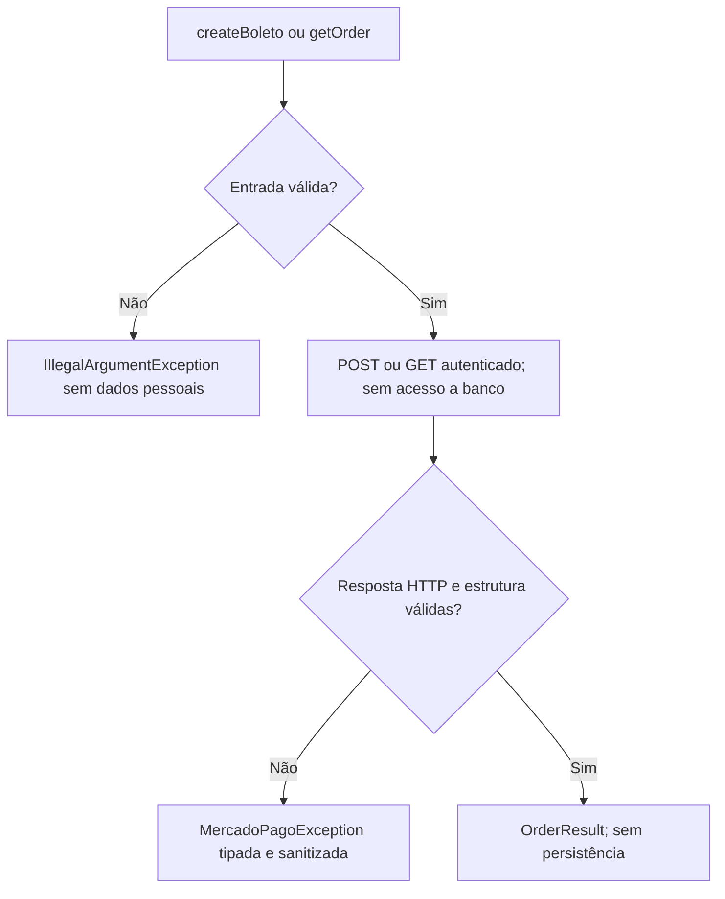

# RFC — TEC-02: gateway de boleto Mercado Pago (Etapa 1)

| Campo | Valor |
|---|---|
| Status | Aprovada na Etapa 1; emissão e consulta homologadas em conta de teste |
| Time / Autor | SI600 / Samuel Lima, com assistência Codex |
| Data | 03/11/2026 |
| Versão | 1.3 |

## Contextualização

### Entendendo o problema

O time precisa de um contrato backend pequeno e verificável para criar e consultar
boletos, antes de integrar regras de Projeto e Taxa. O PDF externo chamado
`ADR 006 -Integracao Mercado Pago.pdf` identifica-se internamente como ADR 005.
Esta RFC mantém seu nome de arquivo distinto para não sobrescrever ADRs existentes.

### Explicando a solução de forma macro

`MercadoPagoGateway` expõe `createBoleto` e `getOrder`. O adaptador usa RestClient,
Orders API, uma order com uma transação, valores BigDecimal e credencial backend.
Recebe UUIDs de referência e idempotência do chamador; nunca cria outra chave numa
repetição. Retorna estados externos sem presumir aprovação ou alterar o domínio.
Não implementa PaymentService, endpoints, webhook, banco, Pix ou cancelamento.
O resultado expõe opcionalmente o vencimento recebido em date_of_expiration,
sem inferir uma data quando o provedor não a informa.
O resultado também preserva o HTTP da resposta para evidência da homologação.

### Alternativas Descartadas e Trade-offs

- SDK Java: dispensável neste spike; útil se futuramente reduzir manutenção.
- Payments API: não segue a Orders API escolhida no ADR.
- Endpoint temporário: exporia emissão antes de autorização e recuperação persistente.
- Banco financeiro antecipado: amplia o escopo e mistura infraestrutura com negócio.

## Implementação

### Diretriz Obrigatória de Testes

Testes de integração atravessam o gateway público e HTTP real contra stub local
(JDK HttpServer). Apenas Mercado Pago é simulado: nenhum repository ou módulo
interno é mockado. Cobertura boa, ruim e incompleta conforme ADRs 0001 e 0002.
O teste real de sandbox é opt-in, isolado e não carrega a aplicação ou banco.
O backend e o experimento compartilham `mercadopago.yml`, com import nativo de
`.env` em formato Properties. Não há dependência dotenv. Ambiente do processo
prevalece sobre arquivos; os testes comuns ficam isolados de credenciais locais.
Sandbox exige token novo e confirmação explícita TEST_ACCOUNT antes de qualquer
chamada real. Configurar MP_ENABLED não ativa o experimento.

### Rotas Propostas

Nenhuma rota pública da aplicação. Somente chamadas externas:

| Método | Caminho | Entrada | Saída |
|---|---|---|---|
| POST | /v1/orders | BoletoRequest validado | OrderResult com IDs, valor, estados e boleto transitório |
| GET | /v1/orders/{id} | ID ORD válido | OrderResult; uma chamada por consulta explícita |

### Banco de Dados (Diagrama ER)

Não aplicável: nenhuma entidade, tabela ou migration nesta etapa.

### Desenho de Fluxo (As Seis Perguntas Obrigatórias)

1. As operações são POST e GET externos acima, sem controller SI600.
2. Validar entrada, configuração e resposta; nenhuma consulta ao banco.
3. Preservar HTTP externo em exceção tipada; sem status HTTP próprio nesta etapa.
4. Nada é persistido. Timeout de criação significa resultado desconhecido.
5. Construir OrderResult, permitindo ausência temporária de transação em processamento.
6. Aceitar sucesso 2xx; resposta inválida é erro de protocolo, não sucesso financeiro.

### Fluxos Detalhados Textuais (Cobertura Tripartite ADR 0002)

#### Casos Bons

Criar boleto e consultar order: validar headers, JSON, valor com duas casas,
expiration_time dentro do pagamento, IDs, estados da order e da transação.
Preservar estados desconhecidos e respostas assíncronas sem inventar baixa.

#### Casos Ruins

Classificar 400/422, 401/403, 404, 409, 429, 5xx e falhas de transporte.
Expor Retry-After como duração para o chamador, sem esperar nem repetir
automaticamente. Não logar corpo, token, documento ou boleto.

#### Casos Incompletos

Rejeitar valor inválido, chave ausente, endereço incompleto e ID com path/query.
Rejeitar JSON de sucesso malformado ou identificadores essenciais ausentes.

## Principal Desafio

- Qual é: criação remota pode acontecer antes de um timeout.
- Por que é difícil: não existe atomicidade entre HTTP e o futuro banco local.
- Como o desenho resolve nesta etapa: mesma chave fornecida pelo chamador,
  classificação de resultado incerto e nenhuma repetição automática. Não é
  emissão operacional; persistência e recuperação são pré-requisitos futuros.

## Contratos e segurança das próximas etapas

PaymentService continuará independente de Project e ProjectFee. Uma interface
ou evento PaymentStatusChanged deverá informar mudanças confirmadas aos módulos
integradores, após persistência, com identidade do pagamento e estados anterior/novo.
O transporte confiável desse evento será definido junto com a transação local.
Antes de expor emissão: idempotência persistente, recuperação, autenticação técnica,
fonte confiável de valores/pagador e autorização de acesso. Webhook assinado
deverá confirmar via GET, sem polling implícito ou consultas duplicadas.

## Fontes e validação

Consultadas em 03/11/2026:

- [Boleto](https://www.mercadopago.com.br/developers/pt/docs/checkout-api-orders/payment-integration/websites/boleto)
- [Sandbox](https://www.mercadopago.com.br/developers/pt/docs/checkout-api-orders/integration-test/boleto)

Diferenças em relação ao PDF: a documentação orienta S/N para número ausente e
aceita e-mail válido sem domínio específico no teste. Vencimento do pagamento
não se confunde com expiração da order. O gateway usa a política do ADR de 3–30
dias; compatibilidade com prazo do Projeto pertence ao futuro chamador.
O [relatório de homologação](../mercado-pago-homologacao-boleto.md) registra a
emissão 201, consulta 200 e replay 409 realizados com conta test_user confirmada.
Pessoa jurídica, processamento assíncrono e recuperação após timeout continuam
pendentes. Fixtures locais não substituem a evidência de sandbox real.

## Processo

Trabalho na branch pessoal member/samuel-lima conforme CONTEXT.md e instruções
da sessão. RFC escrita antes do código. A instrução explícita de não executar
commit prevalece sobre a exigência de primeiro commit da RFC. Antes de integração,
seguir git-flow, testes, Gatekeeper e revisão humana. Não avançar à Etapa 2.
