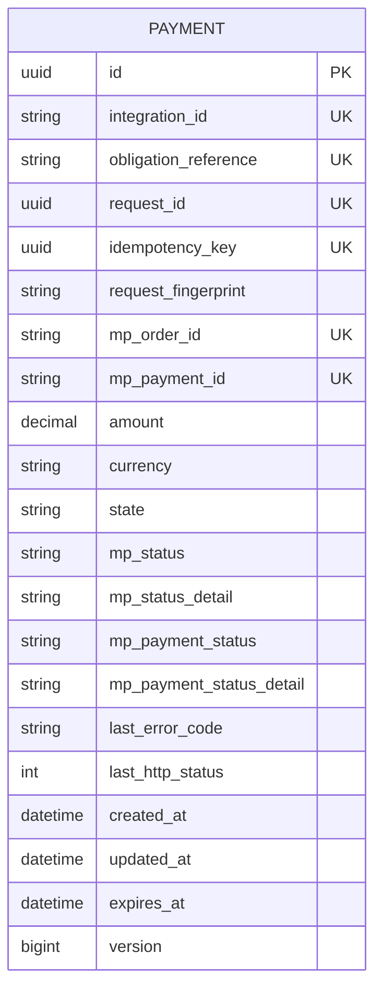
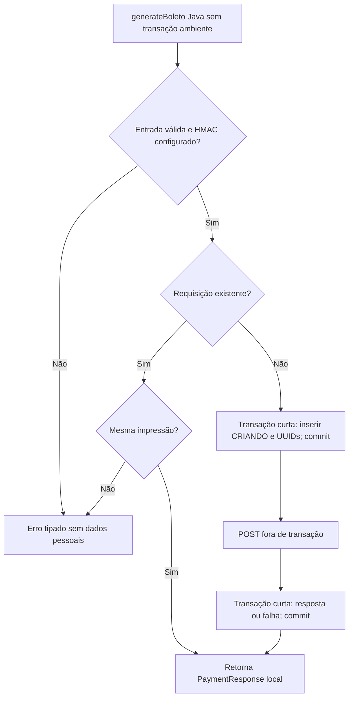

# RFC — TEC-02: PaymentService e persistência mínima (Etapa 2)

| Campo | Valor |
|---|---|
| Status | Aprovada no escopo solicitado da Etapa 2 |
| Autor | SI600 / Samuel Lima, com assistência Codex |
| Data | 03/11/2026 |
| Versão | 1.0 |

## Contextualização

### Entendendo o problema

A homologação mostrou que o POST repetido com a mesma chave retorna 409.
Sem persistência antes do HTTP, repetir pode perder a associação entre a
requisição e a cobrança. Não há atomicidade entre PostgreSQL e Mercado Pago.

### Explicando a solução de forma macro

PaymentService é uma interface Java para geração, leitura local, recuperação do
boleto e sincronização. Payment guarda somente identificadores, valor BRL,
estados, datas e impressão HMAC da entrada; não guarda pagador, boleto ou token.
Não conhece Project/ProjectFee. Não há endpoints, webhook ou chamada real nesta etapa.

### Alternativas Descartadas e Trade-offs

- Repetir POST até obter sucesso: o 409 não recupera a order e timeout é ambíguo.
- Uma transação envolvendo HTTP: mantém locks/conexões e não torna o HTTP atômico.
- Busca remota por referência: não faz parte do gateway homologado; não será presumida.
- Permitir outra tentativa após falha: exige política de reabertura fora do escopo.

## Implementação

### Diretriz Obrigatória de Testes

Seams aprovados: PaymentService público, JPA/banco e HTTP externo via gateway real.
Somente Mercado Pago é substituído por HttpServer. Cobertura boa, ruim e
incompleta conforme ADRs 0001/0002, incluindo concorrência e constraints.
Regressão Java 21; banco PostgreSQL isolado adicional quando disponível.

### Operações (nenhuma rota HTTP)

| Operação Java | Comportamento |
|---|---|
| generateBoleto(command) | Reserva e commita antes do POST; mesma requisição retorna registro local |
| getPayment(integrationId, paymentId) | Somente banco, sem GET externo |
| getBoleto(integrationId, paymentId) | Um GET se a order for conhecida; retorna dados transitórios |
| synchronizeOrder(integrationId, paymentId) | Um GET da order conhecida e aplicação transacional |
| synchronizeOrder(integrationId, paymentId, candidateOrderId) | Recuperação: verifica candidato por GET antes de associar |

O chamador Java é backend confiável e fornece integração, dados/valor autorizados
e referência estável da obrigação. UUID não substitui autorização. Chamadores
HTTP futuros exigem autenticação técnica; não são implementados aqui.

### Banco de Dados (Diagrama ER)

UKs compostas: (integration_id, request_id) e (integration_id, obligation_reference).
As demais UKs são individuais e IDs externos nulos são permitidos. Uma obrigação
permanece reservada inclusive em FALHOU/PAGO: reabertura não pertence a esta etapa.
As constraints funcionam sem índice parcial específico de banco.

### Desenho de Fluxo (As Seis Perguntas Obrigatórias)

1. Não há endpoint: apenas métodos Java descritos acima.
2. Validar entrada e HMAC, consultar requisição, reservar com constraints.
3. Erros Java tipados: entrada, conflito, acesso/recurso ausente, configuração e persistência.
4. Estados: CRIANDO, GERADO, INCERTO, FALHOU, PAGO, CANCELADO, EXPIRADO.
5. PaymentResponse sem pagador/boletos; BoletoDetailsResponse transitório no GET.
6. Sem HTTP próprio. Erro do POST é registrado e devolvido no estado da tentativa;
   falha de consulta propaga exceção sanitizada sem invalidar a cobrança existente.

### Fluxos Detalhados Textuais

#### Casos Bons

Uma reserva vencedora realiza um POST. Corridas de mesma requisição retornam
a reserva existente; outra requisição para a mesma obrigação recebe conflito.
Consulta local não usa a API. getBoleto faz somente um GET e sincroniza o registro.

#### Casos Ruins

Timeout, 409, 402, 423, 5xx ou resposta inconsistente mantêm tentativa INCERTO.
Erros conclusivos de entrada/autenticação/rate limit ficam FALHOU, mas continuam
reservando a obrigação. Nunca há retry automático, inclusive após restart.
Se o resultado remoto não puder ser persistido, CRIANDO permanece bloqueado.
Sem order ID, getBoleto exige recuperação; sincronização simples não inventa ID.
Recuperação recebe ID candidato (painel do provedor ou futura entrada autenticada),
faz GET e confere external_reference == Payment.id, valor e vínculo exclusivo.
Não confia no simples fornecimento do ID. Não presume GET por referência.

#### Casos Incompletos

Rejeitar identidade/referência vazias, requestId ausente, moeda diferente de BRL,
pagador incompleto, valor inválido e nova entrada diferente para o mesmo requestId.
Não registrar PII ou payload bruto em exceções, eventos ou logs.

## Principal Desafio

- Qual é: garantir uma emissão mesmo com concorrência e falha entre HTTP e commit.
- Por que é difícil: POST pode ter ocorrido sem resposta ou sem commit local.
- Como resolve: reserva permanente antes do HTTP, constraints, locks no update,
  nenhuma reemissão e recuperação por GET verificado. Sem ID candidato a recuperação
  é assistida; não existe recuperação automática segura prometida pelo contrato atual.

## Estados, eventos e configuração

Estados externos são preservados separadamente. PAGO exige GET autenticado com
order e pagamento processed/accredited; gerar boleto não confirma quitação.
Snapshots pendentes não rebaixam PAGO nem sobrescrevem seu snapshot confirmado.
Mudança interna publica PaymentStatusChanged após commit, sem PII. O evento é
local e best effort, sem garantia de entrega durável/outbox nesta etapa.

PAYMENT_FINGERPRINT_SECRET exige pelo menos 32 bytes UTF-8 para HMAC-SHA256.
Seu valor não é versionado; manter estável para comparar tentativas existentes.
Rotação com versionamento da chave será necessária antes de uma política de rotação
operacional. Nenhum dado do pagador é persistido para viabilizar retries.

Os métodos com HTTP rejeitam transação ambiente, impedindo que um chamador mantenha
sua transação aberta durante HTTP. A leitura local permite transação ambiente e
usa uma nova transação somente de leitura. TransactionTemplate controla os trechos JPA.
Produção usa ddl-auto=validate: aplicar o SQL revisado antes de habilitar o módulo.
RFC escrita antes do código; permanece sem commit conforme instrução do usuário.
Não avançar para endpoints e webhook.
