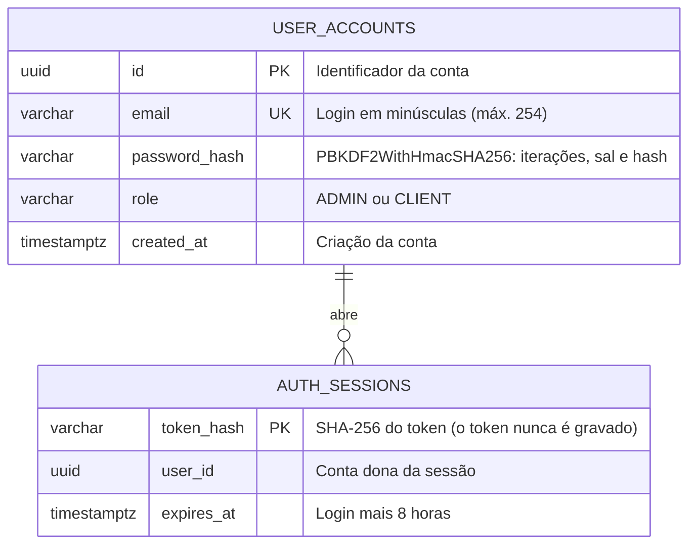
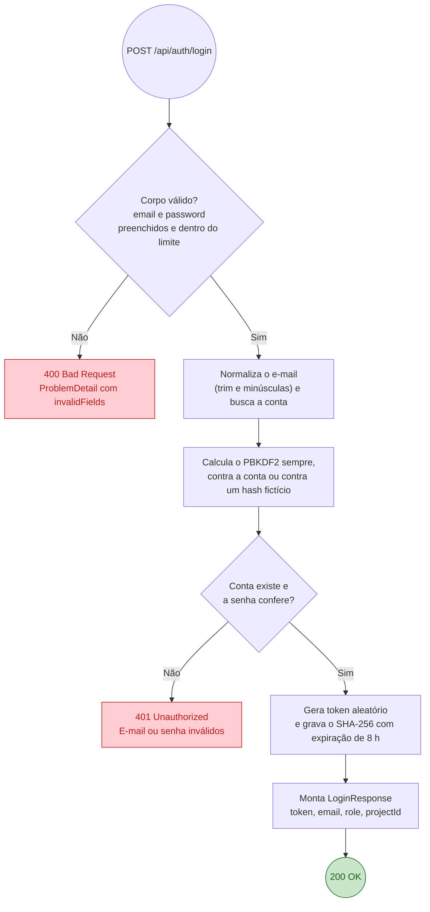

# RFC: US-01 - Login e Perfis de Acesso

| **Status** | Implementado |
|---|---|
| **Data** | 09/11/2026 |
| **Versão** | 1.0 |

---

## Contextualização

### Entendendo o problema
Até a US-03 a identidade de quem chamava a API vinha dos cabeçalhos `X-Authenticated-User-Id` e `X-Authenticated-User-Role`, preenchidos pelo próprio navegador (`MOCK_ROLE`, `MOCK_ACTOR_ID`). Qualquer pessoa podia se declarar `ADMIN`. A issue #10 pede que o usuário entre com e-mail e senha, veja apenas o que é do seu perfil, e possa sair.

Critérios de aceite da issue:
- Login válido leva à tela do perfil correspondente; credenciais inválidas exibem erro.
- O Cliente não acessa telas nem endpoints de Admin e enxerga apenas o próprio Projeto.
- Deve existir logout.

### Explicando a solução de forma macro
- **Contas (`user_accounts`):** e-mail, hash da senha e perfil (`ADMIN` ou `CLIENT`). O Admin inicial é criado na subida do backend por `AdminSeed`, a partir de `ADMIN_EMAIL` e `ADMIN_PASSWORD`. O Cliente ganha conta quando o Admin cria o Projeto (US-03): o login é o `contactEmail` do projeto e a senha é uma senha provisória aleatória.
- **Senha provisória:** enviada por e-mail ao Cliente depois do commit da transação (se o projeto der rollback, nenhum e-mail sai) e devolvida no campo `provisionalPassword` da resposta de `POST /api/projects`, uma única vez, para o Admin repassá-la. Se o e-mail já tinha conta, nada é criado e o campo é omitido.
- **Sessões (`auth_sessions`):** `POST /api/auth/login` devolve um token aleatório de 256 bits. Só o SHA-256 do token é gravado. A sessão dura 8 horas.
- **Identidade nas requisições:** `ActorFilter` lê `Authorization: Bearer <token>`, busca a sessão e coloca o `Actor` na requisição. Sem token ou com token inválido ou expirado a resposta é `401`. Os controllers e serviços existentes continuam usando `ActorResolver`, sem mudança.
- **Frontend:** `LoginPage` chama `/auth/login`, guarda a sessão em `localStorage` (`AUTH_SESSION`) e o Axios envia o token em cada requisição. Um `401` fora do login limpa a sessão e volta à tela de login. O botão **Sair** chama `/auth/logout`.
- **Cabeçalhos legados:** só valem com `app.security.legacy-headers=true`, ligado apenas no `application.yml` de teste para os testes antigos. A aplicação **não sobe** com o profile `prod` e essa flag ligada.

### Alternativas Descartadas e Trade-offs
- *JWT sem estado* — descartado porque o logout precisa revogar o token de verdade, o que exigiria uma lista de bloqueio no servidor, ou seja, o mesmo estado que a tabela de sessões já resolve. Seria vantajoso apenas com várias instâncias do backend sem banco compartilhado.
- *Spring Security com BCrypt* — descartado para não adicionar dependência e configuração pesada a um sistema com dois perfis e poucas rotas. O PBKDF2 do JDK atende e o hash guarda o número de iterações, então dá para aumentá-lo depois. Seria vantajoso se a aplicação precisasse de OAuth2, múltiplos fluxos de autenticação ou autorização por método.
- *Cookie `HttpOnly` em vez de `localStorage`* — descartado nesta entrega porque exige CORS com credenciais e proteção contra CSRF. É a evolução prevista para reduzir o impacto de uma falha de XSS (ver "Evoluções previstas").
- *Provedor de identidade externo (Keycloak, Auth0)* — descartado por exigir infraestrutura fora do escopo do projeto. Seria vantajoso com login social, SSO ou política de senhas gerenciada por terceiros.

---

## Implementação

### Diretriz Obrigatória de Testes
> [!IMPORTANT]
> Conforme as [ADR 0001](../adr/0001-estrategia-de-testes-integracao-e-e2e.md) e [ADR 0002](../adr/0002-padroes-de-cenarios-de-teste-bons-ruins-incompletos.md), os testes rodam nos seams públicos (HTTP real com banco, ou navegador via Cypress), sem mocks de banco ou de serviços internos, e cobrem Casos Bons, Ruins e Incompletos.

### Rotas

| Método | Caminho | Perfil | O que faz | Saídas |
|---|---|---|---|---|
| `POST` | `/api/auth/login` | Público | Valida e-mail e senha e abre uma sessão. Entrada: `email`, `password`. Resposta: `token`, `email`, `role`, `projectId` (só `CLIENT`). | `200`; `400` (campos nulos, em branco ou acima do limite: e-mail 254, senha 200; ProblemDetail com `invalidFields`); `401` (credenciais inválidas) |
| `POST` | `/api/auth/logout` | Autenticado | Apaga a sessão do token informado. | `204`; `401` |
| `GET` | `/api/auth/me` | Autenticado | Devolve `email`, `role` e `projectId` da sessão atual. | `200`; `401` |
| `POST` | `/api/projects` | `ADMIN` | Passa a criar também a conta do Cliente e devolver `provisionalPassword` quando a conta é nova. | `201`; demais códigos como na US-03 |

Todas as demais rotas, exceto `GET /api/health`, exigem `Authorization: Bearer <token>`.

### Banco de Dados (Diagrama ER)

### Desenho de Fluxo da Rota (`POST /api/auth/login`)

As seis perguntas para `POST /api/auth/login`:
1. Endpoint: `POST /api/auth/login`.
2. Validações e consultas: Bean Validation do corpo; busca da conta por e-mail normalizado; comparação do PBKDF2.
3. Desvios: `400` (corpo inválido), `401` (credenciais inválidas, mesma mensagem para e-mail inexistente e senha errada).
4. Banco: uma linha nova em `auth_sessions`. Nenhuma escrita nos desvios de erro.
5. DTO: `LoginResponse` (`token`, `email`, `role`, `projectId`).
6. Sucesso: `200 OK`.

### Fluxos Detalhados (Cobertura Tripartite, ADR 0002)

Testes em `AuthIntegrationTest` (backend, com `legacy-headers=false`, como em produção) e `login.cy.ts` (E2E, desktop e mobile).

#### 1. Casos Bons
1. Admin entra, recebe `role=ADMIN` sem `projectId` e acessa as rotas de Admin.
2. Cliente entra (e-mail em qualquer caixa e com espaços) e recebe o id do próprio projeto; consulta o próprio projeto e `/auth/me`.
3. Logout apaga a sessão e o token deixa de valer.
4. Criar projeto gera a conta do Cliente, envia a senha provisória por e-mail e a devolve na resposta; o Cliente entra com ela.
5. Criar projeto para e-mail que já tem conta não recria acesso, não envia e-mail e não devolve senha.
6. A limpeza de sessões expiradas remove só as expiradas e não roda dentro do login.

#### 2. Casos Ruins
1. Senha errada e e-mail inexistente respondem `401` com a mesma mensagem e não criam sessão.
2. Cliente recebe `403` em `/projects/admin`, `/admin/quotes` e `POST /projects`, e não cria conta.
3. Cliente não enxerga projeto de outro Cliente (`403` ou `404`, sem vazar o e-mail do outro).
4. Requisição sem token, ou com cabeçalhos `X-Authenticated-User-*` forjados, recebe `401`.
5. Token inventado ou expirado recebe `401`.
6. A aplicação não sobe com o profile `prod` e `app.security.legacy-headers=true` (`LegacyHeadersProductionGuardIntegrationTest`).

#### 3. Casos Incompletos
1. Corpo `{}` ou com campos `null` responde `400` com `invalidFields` para e-mail e senha.
2. Campos vazios, só com espaços ou ausentes respondem `400` apontando o campo certo.
3. Corpo vazio, `null`, JSON malformado ou array respondem `400` com ProblemDetail.
4. E-mail acima de 254 e senha acima de 200 caracteres respondem `400`.
5. No navegador, formulário em branco ou só com o e-mail não chama o backend.

---

## Principal Desafio

- **Qual é:** autenticar sem revelar quais e-mails têm conta e sem criar contenção no banco entre logins simultâneos.
- **Por que é difícil:** responder mais rápido quando o e-mail não existe, ou com outra mensagem, permite descobrir contas cadastradas. Limpar sessões expiradas dentro do `login` faz logins concorrentes disputarem lock na tabela `auth_sessions`.
- **Como o desenho resolve:** o PBKDF2 é calculado sempre, contra um hash fictício quando a conta não existe, e a mensagem de erro é única. A limpeza de sessões expiradas fica no `SessionCleanupScheduler` (`@Scheduled`, `fixedDelay`, uma exclusão em massa), fora do `login`.

## Evoluções previstas
- Trocar `localStorage` por cookie `HttpOnly` (exige CORS com credenciais e proteção contra CSRF).
- Limite de tentativas de login.
