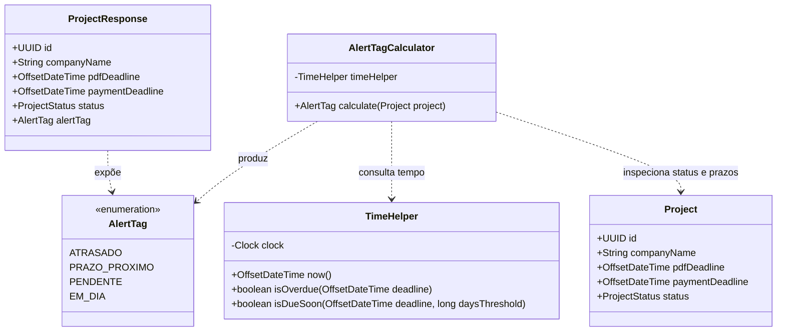
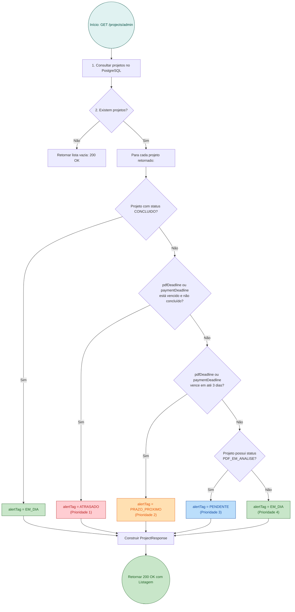

# RFC — US-09: Geração de Tags de Alerta (de Prazo) no Projeto

| | |
|---|---|
| **Status** | **Aprovada** |
| **Time / Autor** | João Pedro Leite Calsavara (@197837) |
| **Data** | 20/10/2026 |
| **Versão** | 1.0 |

---

## Contextualização

### Entendendo o problema
No gerenciamento de feiras e eventos corporativos, a montagem física e o equilíbrio financeiro dependem estritamente do cumprimento de prazos pré-estabelecidos com os expositores (Clientes). Cada projeto arquitetônico cadastrado possui duas datas limites fundamentais: a data limite para submissão do PDF da planta (`pdfDeadline`) e a data limite para quitação das taxas de participação (`paymentDeadline`).

No modelo operacional atual, a listagem e os detalhes de projetos apresentam apenas datas isoladas e o status de fluxo (`AGUARDANDO_PDF`, `PDF_EM_ANALISE`, `APROVADO`, `AGUARDANDO_PAGAMENTO`, `CONCLUIDO`). Isso impõe aos administradores da feira a necessidade de conferência manual contínua entre o calendário e o status de cada estande. Do ponto de vista dos expositores, a falta de avisos visuais imediatos aumenta o risco de perda de prazos críticos, acarretando atrasos na montagem e cancelamento da reserva do estande.

### Explicando a solução de forma macro
A funcionalidade introduz o cálculo dinâmico de etiquetas de alerta (`AlertTag`), avaliadas no momento da consulta com base no instante temporal real e nas regras de negócio da máquina de estados do projeto:
- **`ATRASADO`**: Sinaliza que a data limite de envio do PDF ou de pagamento foi ultrapassada sem a respectiva conclusão da etapa.
- **`PRAZO_PROXIMO`**: Sinaliza que a data limite para envio do PDF ou pagamento de taxas está a 3 dias ou menos do vencimento.
- **`PENDENTE`**: Sinaliza pendência operacional em andamento sem estouro de prazos (ex.: PDF submetido pelo cliente aguardando análise e aprovação pelo Administrador).
- **`EM_DIA`**: Sinaliza conformidade total, com prazos regulares superiores a 3 dias ou etapas concluídas.

Quando múltiplos eventos ou pendências coexistirem (ex.: pagamento atrasado e PDF em análise), o backend calcula e retorna a tag de maior criticidade (`ATRASADO` > `PRAZO_PROXIMO` > `PENDENTE` > `EM_DIA`).

### Alternativas Descartadas e Trade-offs

1. **Persistência da tag de alerta em coluna no banco de dados (`projects.alert_tag`)**
   - *Descarte*: Como a proximidade e o atraso de prazos dependem da evolução contínua do tempo (`now()`), persistir a tag tornaria os dados rapidamente obsoletos, a menos que rotinas periódicas de banco ou schedulers pesados executassem a cada minuto.
   - *Cenário viável*: Seria viável caso a base possuísse milhões de registros e houvesse necessidade estrita de indexação e paginação direta por tag via SQL.
2. **Cálculo da tag de alerta exclusivamente no Frontend (React)**
   - *Descarte*: Transferir a regra para o cliente duplicaria lógica sensível de domínio, geraria possíveis discrepâncias com o fuso horário da máquina do usuário e impediria que outros módulos de backend (como a US-10 de notificação por e-mail e a US-18 de dashboard do admin) compartilhassem a mesma regra de ouro.
   - *Cenário viável*: Seria viável apenas em uma arquitetura puramente estática ou desacoplada sem integração de múltiplos serviços de backend.
3. **Array de tags simultâneas (`List<AlertTag>`) no DTO**
   - *Descarte*: Exibir múltiplas badges simultâneas gera poluição visual na interface de monitoramento e contraria o critério de aceite explícito da US-09, que exige o cálculo e a exibição da tag consolidada de maior criticidade.
   - *Cenário viável*: Seria viável em uma visão de auditoria analítica detalhada com filtros multifacetados por pendência.

---

## Implementação

### Diretriz Obrigatória de Testes
> [!IMPORTANT]
> **Padrão do Projeto: Apenas Testes de Integração e E2E (Sem Mocks Unitários)**
> Conforme definido nas [ADR 0001](file:///home/jpcalsavara/projetos/andamento/si600-web-petshop/docs/adr/0001-estrategia-de-testes-integracao-e-e2e.md) e [ADR 0002](file:///home/jpcalsavara/projetos/andamento/si600-web-petshop/docs/adr/0002-padroes-de-cenarios-de-teste-bons-ruins-incompletos.md):
> - Toda funcionalidade é testada exclusivamente nos seams públicos (endpoints HTTP contra o banco de dados PostgreSQL real).
> - Toda suíte de testes deve cobrir a **Matriz Tripartite**:
>   1. **Casos Bons (Happy Path)**: Cálculo correto de `EM_DIA`, `PRAZO_PROXIMO`, `PENDENTE` e `ATRASADO`.
>   2. **Casos Ruins / Precedência (Sad Path)**: Conflito de datas e status concorrentes, garantindo a resolução estrita pela maior gravidade.
>   3. **Casos Incompletos / Limites de Borda (Boundary)**: Projetos sem `paymentDeadline` definido, projetos já com status `CONCLUIDO` ignorando datas passadas, e limites exatos de transição de 3 dias (exatamente 72 horas).

---

### Rotas Afetadas

| Método | Caminho | O que faz | Entrada | Saídas |
|---|---|---|---|---|
| `GET` | `/projects/admin` | Lista projetos para o Admin incluindo o cálculo dinâmico da `alertTag` | `status` (query param opcional) | `200 OK` (`List<ProjectResponse>` com `alertTag`) |
| `GET` | `/projects/{projectId}` | Retorna detalhes do projeto do Cliente com a `alertTag` calculada | `projectId` no path | `200 OK` (`ProjectResponse` com `alertTag`); `404 Not Found` |
| `POST` | `/projects` | Cria projeto e retorna o DTO inicial já com a `alertTag` avaliada | `CreateProjectRequest` | `201 Created` (`ProjectResponse` com `alertTag`); `400 Bad Request` |

---

### Modelo de Dados e Domínio

#### Enumeração `AlertTag`
```java
package br.unicamp.ft.si600.eventos.dto;

public enum AlertTag {
    ATRASADO,
    PRAZO_PROXIMO,
    PENDENTE,
    EM_DIA
}
```

#### Diagrama de Entidades e DTO


---

### Desenho de Fluxo da Rota (As Seis Perguntas Obrigatórias)



---

### Fluxos Detalhados Textuais (Cobertura Tripartite ADR 0002)

#### 1. Casos Bons (Happy Path)
1. **Projeto em dia**: Projeto criado com `pdfDeadline` a 10 dias de distância e status `AGUARDANDO_PDF`. Ao ser consultado via `GET /projects/{id}` ou `/projects/admin`, o backend calcula e retorna `alertTag: "EM_DIA"`.
2. **Projeto com prazo próximo**: Projeto com `pdfDeadline` a 2 dias do instante atual. Retorna `alertTag: "PRAZO_PROXIMO"`.
3. **Projeto atrasado**: Projeto com `pdfDeadline` ultrapassado há 1 dia sem envio do PDF. Retorna `alertTag: "ATRASADO"`.
4. **Projeto com pendência operacional**: Projeto com PDF submetido (`status: "PDF_EM_ANALISE"`) e prazos regulares. Retorna `alertTag: "PENDENTE"`.

#### 2. Casos Ruins / Precedência de Criticidade (Sad Path)
1. **Múltiplos conflitos simultâneos**: Projeto com `paymentDeadline` vencido (`ATRASADO`) e com PDF recém-submetido (`PDF_EM_ANALISE`, que isoladamente seria `PENDENTE`). O cálculo prioriza a regra de maior gravidade e retorna `alertTag: "ATRASADO"`.
2. **Prazo próximo sobrepondo pendência**: Projeto com `pdfDeadline` a 1 dia do vencimento com status `AGUARDANDO_PDF`. Retorna `PRAZO_PROXIMO`.

#### 3. Casos Incompletos / Limites de Borda (Boundary)
1. **Data de pagamento nula**: Projetos no estágio inicial onde `paymentDeadline` ainda não foi estipulado (campo nulo). A avaliação ignora o pagamento sem lançar `NullPointerException` e avalia estritamente o `pdfDeadline`.
2. **Projeto Concluído com datas passadas**: Projeto com status `CONCLUIDO`, cujas datas limites ficaram naturalmente no passado. A avaliação detecta a conclusão do projeto e retorna `EM_DIA`, sem disparar falso positivo de atraso.
3. **Borda exata de 3 dias**: Prazos a exatamente $72$ horas e $1$ segundo (retorna `EM_DIA`), e a exatamente $72$ horas (retorna `PRAZO_PROXIMO`).

---

### Principal Desafio

- **Qual é:** Garantir que o cálculo de prazos seja 100% determinístico e testável em suítes de integração, sem depender da hora do relógio da máquina de execução ou gerar testes frágeis (*flaky tests*).
- **Por que é difícil:** Testes que usam `now()` real falham aleatoriamente se rodarem perto da meia-noite, em fins de semana ou em servidores de CI/CD com fusos horários divergentes.
- **Como o desenho resolve:** Introdução do bean `java.time.Clock` injetável no Spring (`TimeConfiguration`). Em testes, o relógio é fixado deterministicamente via `@TestConfiguration` (`Clock.fixed(...)`), assegurando repetibilidade contínua conforme a [ADR 0001](file:///home/jpcalsavara/projetos/andamento/si600-web-petshop/docs/adr/0001-estrategia-de-testes-integracao-e-e2e.md).

---

### Checklist de Execução (/to-ticket)

- [ ] **1. Infraestrutura Temporal**:
  - [ ] Criar `TimeConfiguration` com bean `@Bean public Clock clock()`.
  - [ ] Criar componente utilitário `TimeHelper` com métodos `now()`, `isOverdue()` e `isDueSoon()`.
  - [ ] Criar `TestClockConfig` para controle temporal nos testes de integração.
- [ ] **2. Domínio e Cálculo de Alerta (Backend)**:
  - [ ] Criar enum `AlertTag` (`ATRASADO`, `PRAZO_PROXIMO`, `PENDENTE`, `EM_DIA`).
  - [ ] Criar serviço `AlertTagCalculator` implementando a matriz de precedência.
  - [ ] Atualizar `ProjectResponse` para conter o campo `AlertTag alertTag`.
  - [ ] Integrar `AlertTagCalculator` em `ProjectPdfService` e `ProjectService`.
- [ ] **3. Testes de Integração Tripartite (Backend)**:
  - [ ] Criar `ProjectAlertTagIntegrationTest` cobrindo Happy Path, Precedência (Sad) e Casos Limítrofes (Incompletos).
- [ ] **4. Frontend (React / Vite)**:
  - [ ] Atualizar tipagens em `src/types/index.ts` adicionando `AlertTag`.
  - [ ] Criar utilitário `src/utils/date.ts` para formatação e checagem de prazos.
  - [ ] Atualizar `ProjectListPage.tsx` e `ProjectListPage.module.scss` adicionando a coluna e badges de alerta.
  - [ ] Atualizar visualização do cliente em `ClientPdfPage` / `ProjectFees`.
- [ ] **5. Qualidade e Gatekeeper**:
  - [ ] Executar testes de integração backend (`./mvnw test`).
  - [ ] Executar testes do frontend (`npm test`).
  - [ ] Executar verificação semântica do AI Gatekeeper (`run_review.sh`).
