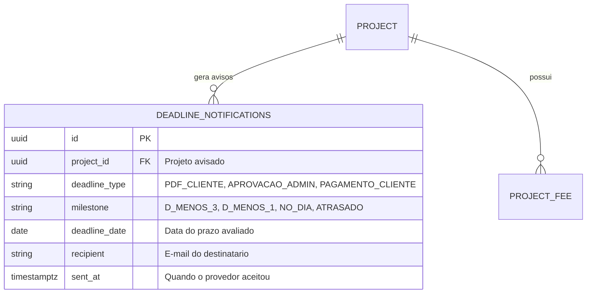
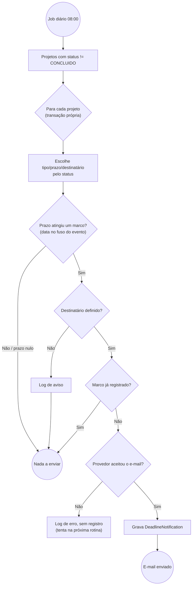

# RFC — US-10: Notificações de prazo por e-mail

| | |
|---|---|
| **Status** | **Aprovada (implementada)** |
| **Time / Autor** | Julyo Elias Hidalgo da Silva |
| **Data** | 03/11/2026 |
| **Versão** | 1.0 |

---

## Contextualização

### Entendendo o problema
Clientes e Admin só descobrem que um prazo está próximo ou vencido se entrarem no sistema (a US-09 mostra tags, mas apenas para quem abre a tela). Prazos perdidos de envio de PDF e de pagamento atrasam a montagem do estande e a arrecadação do evento. O risco oposto é o spam: um e-mail por dia enquanto a pendência existir faria o destinatário ignorar os avisos.

### Explicando a solução de forma macro
Uma rotina diária (padrão 08:00, `America/Sao_Paulo`) avalia cada Projeto em andamento e envia **um e-mail por marco de prazo**: 3 dias antes, 1 dia antes, no dia e atrasado.

- `DeadlineEvaluator` compara **datas** (não horários) no fuso do evento (`ProjectService.EVENT_ZONE`). O marco é o mais avançado já atingido, então uma rotina que ficou um dia fora do ar ainda avisa no dia seguinte.
- `DeadlineNotification` registra cada envio. A chave única `(project_id, deadline_type, milestone, deadline_date, recipient)` impede reenvio. `deadline_date` faz parte da chave para que um novo prazo definido pelo Admin (US-03) volte a notificar sem apagar histórico.
- O registro só é gravado **depois** de o provedor aceitar o e-mail; falha de envio não registra e a rotina seguinte tenta de novo.
- A pendência é reavaliada a cada execução: PDF enviado ou taxa sem pendência encerra os avisos sem passo extra.

| `DeadlineType` | Prazo avaliado | Condição | Destinatário |
|---|---|---|---|
| `PDF_CLIENTE` | `pdfDeadline` | `AGUARDANDO_PDF` ou `REPROVADO` | Cliente (`contactEmail`) |
| `APROVACAO_ADMIN` | `pdfDeadline` | `PDF_EM_ANALISE` | Admin (`GMAIL_ADMIN`, senão `GMAIL_SENDER`) |
| `PAGAMENTO_CLIENTE` | `paymentDeadline` | `APROVADO`/`AGUARDANDO_PAGAMENTO` com taxa pendente | Cliente (`contactEmail`) |

**Taxa pendente:** toda taxa fora do conjunto `SETTLED`. Hoje `SETTLED = {PAGAMENTO_GERADO}`, pois com o boleto gerado (US-11) o Cliente não tem mais ação pendente. Quando a US-12 criar o status "Pago", ele deve ser incluído em `SETTLED`.

### Alternativas Descartadas e Trade-offs
- *Um e-mail por dia enquanto a condição persistir* — descartada: gera spam e contraria a regra da US-10. Seria viável apenas para um canal de baixo atrito (ex.: notificação in-app).
- *Marco avaliado pelo dia exato (sem "mais avançado já atingido")* — descartada: uma falha da rotina em um único dia perderia o aviso para sempre. Seria viável se houvesse monitoramento garantindo execução diária.
- *Fila/outbox com reenvio assíncrono* — descartada: complexidade desproporcional ao volume (dezenas de projetos). O `AsyncEmailSender` engole falhas, por isso o job usa o remetente síncrono (`delegate()`) para só registrar o que realmente saiu. Seria viável com volume alto ou necessidade de retry com backoff.
- *Comparar horários em UTC* — descartada: um prazo "dia 30 às 23h" em São Paulo já cairia no dia seguinte em UTC.

---

## Implementação

### Diretriz Obrigatória de Testes
> [!IMPORTANT]
> Conforme as [ADR 0001](../adr/0001-estrategia-de-testes-integracao-e-e2e.md) e [ADR 0002](../adr/0002-padroes-de-cenarios-de-teste-bons-ruins-incompletos.md), a feature é testada apenas por integração, no seam público `DeadlineNotificationService.run()`, com banco real, relógio mutável (`MutableTestClock`) e `CapturingEmailSender` no lugar do provedor externo. Não há testes unitários POJO: marcos, fuso e resolução do destinatário do Admin são verificados por essa mesma suíte (`DeadlineNotificationIntegrationTest`).

### Rotas Propostas
Nenhum endpoint HTTP novo. A entrada é um job agendado.

| Gatilho | O que faz | Configuração |
|---|---|---|
| `@Scheduled` em `DeadlineNotificationScheduler.runDaily()` | Chama `DeadlineNotificationService.run()` | `notification.deadlines.enabled` (`DEADLINE_JOB_ENABLED`, padrão `true`), `notification.deadlines.cron` (`DEADLINE_CRON`, padrão `0 0 8 * * *`), `notification.gmail.admin-email` (`GMAIL_ADMIN`) |

### Banco de Dados (Diagrama ER)

Restrição única: `uk_deadline_notifications_milestone (project_id, deadline_type, milestone, deadline_date, recipient)`.

### Desenho de Fluxo da Rota (As Seis Perguntas Obrigatórias)

1. **Entrada:** job diário (`@Scheduled`), sem endpoint HTTP.
2. **Validações/consultas:** projetos com status diferente de `CONCLUIDO`; prazo avaliado conforme o status; taxas pendentes (pagamento); marco por data no fuso do evento; destinatário não vazio; existência prévia do registro de envio.
3. **Desvios:** prazo nulo ou a mais de 3 dias, sem destinatário (log de aviso) ou marco já enviado: nada é enviado. Falha no envio: nada é registrado. Exceção em um projeto é logada e não interrompe os demais. Não há resposta HTTP, portanto não há 4xx/5xx.
4. **Alteração no banco:** uma linha em `deadline_notifications` por e-mail aceito pelo provedor.
5. **Saída:** número de e-mails enviados (`int`), registrado em log.
6. **Sucesso:** execução concluída (log informativo).

### Fluxos Detalhados Textuais (Cobertura Tripartite ADR 0002)

#### 1. Casos Bons (Happy Path)
1. Prazo de PDF a 3 dias: o Cliente recebe e-mail com projeto, prazo e ação pendente; o envio é registrado.
2. A sequência de dias gera exatamente um e-mail por marco (3 dias, 1 dia, no dia, atrasado) e nenhum entre marcos.
3. PDF em análise com prazo próximo: o Admin recebe o aviso (em `GMAIL_ADMIN`; sem ele, em `GMAIL_SENDER`).
4. Prazo de pagamento próximo: o Cliente recebe a lista de taxas pendentes.
5. PDF reprovado: o Cliente é orientado a reenviar.

#### 2. Casos Ruins (Sad Path / Regras de Negócio)
1. Falha do provedor: nenhum registro é gravado e a rotina seguinte reenvia.
2. PDF já enviado, projeto aprovado sem taxas ou todas as taxas com pagamento gerado: nenhuma cobrança.
3. Projeto sem e-mail de contato, ou Admin sem `GMAIL_ADMIN` e sem `GMAIL_SENDER`: o aviso é ignorado e os demais projetos seguem.

#### 3. Casos Incompletos (Boundary)
1. Prazo a 4 dias ou mais: sem marco. Prazo a 3 dias, 2 dias, 1 dia, no dia (mesmo com hora já passada) e dia anterior: marcos corretos.
2. Prazo em UTC que cai em outro dia em São Paulo: vale a data no fuso do evento.
3. `GMAIL_ADMIN` em branco ou com espaços: usa/apara conforme a regra de resolução.
4. Prazo alterado pelo Admin: a nova `deadline_date` volta a notificar.

---

## Principal Desafio

- **Qual é:** garantir exatamente um e-mail por marco, sem perder avisos nem duplicá-los.
- **Por que é difícil:** o envio externo e a gravação no banco não são atômicos. Registrar antes de enviar perde o aviso se o envio falhar; enviar antes de registrar pode duplicar se a gravação falhar ou se duas execuções se sobrepuserem. Além disso, o `AsyncEmailSender` esconde falhas do chamador.
- **Como o desenho resolve:** o job usa o remetente síncrono para conhecer o resultado e só registra após o envio aceito (prefere reenviar a perder). A restrição `UNIQUE` composta no banco é a defesa final contra duplicidade e cada projeto é processado em transação própria.
