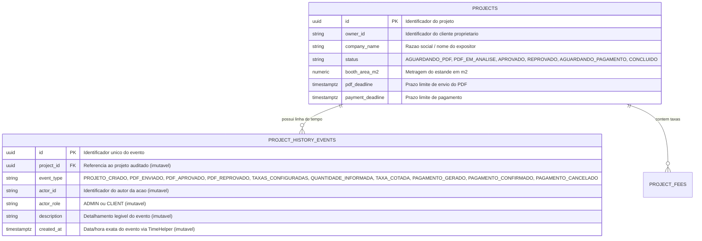

# RFC — US-16: Histórico do Projeto

| | |
|---|---|
| **Status** | **Aprovada** |
| **Time / Autor** | João Pedro Leite Calsavara (@197837) |
| **Data** | 07/11/2026 |
| **Versão** | 1.0 |

---

## Contextualização

### Entendendo o problema
No gerenciamento operacional e comercial de estandes para feiras e eventos corporativos, o ciclo de vida de cada `Projeto` envolve múltiplas interações entre o `Cliente` (Expositor) e o `Administrador`: cadastro do projeto, submissão e reenvio da `Planta` (PDF), aprovação ou reprovação com justificativa, configuração do catálogo de `Taxa`s do estande, preenchimento de quantidades de taxas variáveis, cotação de valores pelo administrador e operações financeiras de `Pagamento`.

No modelo atual, o banco de dados armazena apenas o último estado consolidado em `projects` e `project_fees` (como `pdfUploadedAt`, `decisionBy`, `decisionAt`, `quantityUpdatedAt` e `quotedAt`). Quando ocorrem múltiplos ciclos — por exemplo, uma planta reprovada e posteriormente reenviada e aprovada, ou uma taxa variável cuja quantidade foi retificada pelo expositor e recotada pelo administrador —, os registros anteriores são sobrescritos. Isso impede a rastreabilidade histórica ("o que aconteceu, quando e por quem"), dificultando auditorias operacionais, resolução de disputas sobre prazos e a futura exportação consolidada em CSV (US-17).

### Explicando a solução de forma macro
A solução introduz uma trilha de auditoria imutável (`ProjectHistoryEvent`) associada ao `Projeto`, alimentada automaticamente dentro da mesma transação de banco de dados de cada ação de negócio relevante:
- **`PROJETO_CRIADO`**: Registro automático no ato de criação do projeto pelo Administrador.
- **`PDF_ENVIADO`**: Registro automático no envio inicial ou reenvio da planta em PDF pelo Cliente, incluindo nome do arquivo e metragem informada.
- **`PDF_APROVADO`**: Registro automático na aprovação da planta pelo Administrador, incluindo a metragem homologada em m².
- **`PDF_REPROVADO`**: Registro automático na reprovação da planta pelo Administrador, preservando a justificativa exigida.
- **`TAXAS_CONFIGURADAS`**: Registro automático quando o Administrador vincula ou atualiza as taxas aplicáveis ao projeto.
- **`QUANTIDADE_INFORMADA`**: Registro automático quando o Cliente salva a quantidade de uma taxa variável.
- **`TAXA_COTADA`**: Registro automático quando o Administrador registra ou atualiza o valor cotado de uma taxa variável.
- **`PAGAMENTO_GERADO`**, **`PAGAMENTO_CONFIRMADO`**, **`PAGAMENTO_CANCELADO`**: Tipos de evento e métodos de domínio já disponibilizados em `ProjectHistoryService` para integração imediata com os fluxos de pagamento (US-11, US-12 e US-15).

Os eventos são expostos de forma estritamente somente leitura por meio do endpoint `GET /projects/{projectId}/history` em ordem cronológica crescente (`createdAt ASC, id ASC`), garantindo isolamento de pertença (um `Cliente` acessa exclusivamente o histórico de seu próprio `Projeto`, enquanto o `Administrador` consulta qualquer projeto). Na interface React, tanto o Cliente (via aba "Histórico" em `ClientPdfPage`) quanto o Administrador (via ação "Histórico" em `ProjectListPage`) visualizam a linha do tempo auditável sem qualquer opção de edição ou remoção.

### Alternativas Descartadas e Trade-offs

1. **Reconstrução virtual do histórico a partir das colunas de timestamp de `projects` e `project_fees`**
   - *Descarte*: As colunas atuais das entidades guardam apenas o último estado. Caso um PDF seja reprovado e depois reenviado e aprovado, a data e a justificativa da reprovação anterior são limpas (`decisionBy = null`, `rejectionJustification = null`), perdendo o histórico real.
   - *Cenário viável*: Seria viável apenas se cada projeto admitisse uma única transição linear sem possibilidade de reenvio, recotação ou reabertura de pagamento.
2. **Tabela de auditoria genérica baseada em triggers de banco de dados (CDC / Hibernate Envers)**
   - *Descarte*: Captura diffs técnicos de colunas de baixo nível em vez de eventos de domínio semânticos na Linguagem Ubíqua do sistema, dificultando a exibição direta para o Cliente e a exportação em linguagem de negócio na US-17.
   - *Cenário viável*: Seria vantajoso para auditoria forense de infraestrutura ou conformidade regulatória de alterações em todas as tabelas do esquema.
3. **Permitir inserção manual de comentários ou edição/exclusão de eventos pelo Administrador**
   - *Descarte*: Viola diretamente os Critérios de Aceite da US-16, que determinam que o histórico seja estritamente somente leitura e reflita fielmente as ações executadas no sistema sem adulteração retroativa.
   - *Cenário viável*: Seria aplicável apenas em um módulo separado de chat/mensageria entre expositor e organização.

---

## Implementação

### Diretriz Obrigatória de Testes
> [!IMPORTANT]
> **Padrão do Projeto: Apenas Testes de Integração e E2E (Sem Mocks Unitários)**
> Conforme definido nas [ADR 0001](file:///home/jpcalsavara/projetos/andamento/si600-web-petshop/docs/adr/0001-estrategia-de-testes-integracao-e-e2e.md) e [ADR 0002](file:///home/jpcalsavara/projetos/andamento/si600-web-petshop/docs/adr/0002-padroes-de-cenarios-de-teste-bons-ruins-incompletos.md):
> - Toda funcionalidade deve ser testada exclusivamente nos seams públicos (endpoints HTTP reais contra o banco de dados PostgreSQL de integração ou testes E2E no navegador). Mocks de banco ou de serviços internos são estritamente proibidos.
> - Toda suíte de testes deve cobrir a **Matriz Tripartite**:
>   1. **Casos Bons (Happy Path)**: geração automática de eventos ao longo da jornada do projeto (criação, envio de PDF, reprovação, reenvio, aprovação, configuração de taxas, envio de quantidade e cotação) e listagem em ordem cronológica crescente via `GET /projects/{projectId}/history` tanto pelo Cliente proprietário quanto pelo Administrador.
>   2. **Casos Ruins (Sad Path / Regras de Negócio)**: tentativa de acesso ao histórico por Cliente não proprietário do projeto (`403 Forbidden`), consulta a projeto inexistente (`404 Not Found`), requisição sem autenticação (`401 Unauthorized`), e garantia de que falhas nas operações de negócio (ex.: PDF inválido ou reprovação sem justificativa) fazem rollback completo e não gravam eventos fantasmas no histórico.
>   3. **Casos Incompletos / Imutabilidade (Boundary & Malformed Payloads)**: `projectId` malformado na URL (`400 Bad Request` com RFC 7807) e tentativas de mutação (`POST`, `PUT`, `PATCH`, `DELETE`) no endpoint `/projects/{projectId}/history` rejeitadas com `405 Method Not Allowed`.

---

### Rotas Propostas e Afetadas

| Método | Caminho | O que faz | Entrada (campos relevantes) | Saídas (status e códigos RFC 7807) |
|---|---|---|---|---|
| `GET` | `/projects/{projectId}/history` | Lista a linha do tempo de eventos do projeto em ordem cronológica crescente | `projectId` (UUID no path), headers de autenticação (`X-Authenticated-User-Id`, `X-Authenticated-User-Role`) | `200 OK` (`List<ProjectHistoryEventResponse>`); `400 Bad Request` (UUID inválido); `401 Unauthorized`; `403 Forbidden` (Cliente não proprietário); `404 Not Found` (Projeto inexistente); `405 Method Not Allowed` (`POST`/`PUT`/`DELETE`) |
| `POST` | `/projects` | Cria projeto e registra evento `PROJETO_CRIADO` | `CreateProjectRequest` | `201 Created` |
| `POST` | `/projects/{projectId}/pdf` | Envia/reenvia PDF e registra evento `PDF_ENVIADO` | `file`, `areaM2` | `200 OK` |
| `POST` | `/projects/admin/{projectId}/approve` | Aprova PDF e registra evento `PDF_APROVADO` | `ApproveProjectRequest` (`approvedAreaM2`) | `200 OK` |
| `POST` | `/projects/admin/{projectId}/reject` | Reprova PDF e registra evento `PDF_REPROVADO` | `DecisionRequest` (`justification`) | `200 OK` |
| `PUT` | `/projects/{projectId}/fees/configuration` | Configura taxas do projeto e registra evento `TAXAS_CONFIGURADAS` | `ProjectFeeConfigurationRequest` (`feeIds`) | `200 OK` |
| `PUT` | `/projects/{projectId}/fees/{projectFeeId}/quantity` | Informa quantidade de taxa variável e registra evento `QUANTIDADE_INFORMADA` | `FeeQuantityRequest` (`quantity`) | `200 OK` |
| `PUT` | `/projects/{projectId}/fees/{projectFeeId}/quote` | Registra cotação de taxa variável e grava evento `TAXA_COTADA` | `QuoteRequest` (`amount`) | `200 OK` |

---

### Banco de Dados (Diagrama ER)



---

### Desenho de Fluxo da Rota (As Seis Perguntas Obrigatórias)

```mermaid
flowchart TD
    START((Inicio: GET /projects/{projectId}/history)) --> VALIDATE_UUID{"1. projectId e um\nUUID valido?"}

    VALIDATE_UUID -- "Nao" --> ERR_400["Erro 400 Bad Request\n(RFC 7807 Invalid UUID)"]
    VALIDATE_UUID -- "Sim" --> CHECK_PROJECT{"2. Projeto existe\nno PostgreSQL?"}

    CHECK_PROJECT -- "Nao" --> ERR_404["Erro 404 Not Found\n(Projeto nao encontrado)"]
    CHECK_PROJECT -- "Sim" --> CHECK_AUTH{"3. Ator e ADMIN ou\nCLIENT dono do projeto?"}

    CHECK_AUTH -- "Nao (Outro Cliente)" --> ERR_403["Erro 403 Forbidden\n(Acesso negado ao projeto)"]
    CHECK_AUTH -- "Sim" --> QUERY_EVENTS["4. Consultar project_history_events\nORDER BY created_at ASC, id ASC"]

    QUERY_EVENTS --> BUILD_DTO["5. Mapear para List<ProjectHistoryEventResponse>\n(somente leitura)"]
    BUILD_DTO --> SUCCESS((6. Sucesso: 200 OK))

    style ERR_400 fill:#ffcdd2,color:#b71c1c,stroke:#b71c1c
    style ERR_404 fill:#ffcdd2,color:#b71c1c,stroke:#b71c1c
    style ERR_403 fill:#ffcdd2,color:#b71c1c,stroke:#b71c1c
    style SUCCESS fill:#c8e6c9,color:#1b5e20,stroke:#1b5e20
    style START fill:#e0f2f1,color:#004d40,stroke:#004d40
```

---

### Fluxos Detalhados Textuais (Cobertura Tripartite ADR 0002)

#### 1. Casos Bons (Happy Path)
1. **Registro Automático em Operações do Projeto**:
   - Quando o Admin cria um projeto (`POST /projects`), o sistema persiste um evento `PROJETO_CRIADO` com `actorId`, `actorRole: "ADMIN"` e descrição da criação.
   - Quando o Cliente envia ou reenvia a planta (`POST /projects/{id}/pdf`), o sistema persiste `PDF_ENVIADO` com o nome do arquivo e área declarada.
   - Quando o Admin aprova (`POST /projects/admin/{id}/approve`) ou reprova (`POST /projects/admin/{id}/reject`) a planta, o sistema persiste `PDF_APROVADO` (com a área homologada) ou `PDF_REPROVADO` (com a justificativa).
   - Quando o Admin configura as taxas (`PUT /projects/{id}/fees/configuration`), o sistema persiste `TAXAS_CONFIGURADAS`.
   - Quando o Cliente informa a quantidade de taxa variável (`PUT /projects/{id}/fees/{pfId}/quantity`), o sistema persiste `QUANTIDADE_INFORMADA`.
   - Quando o Admin cota a taxa variável (`PUT /projects/{id}/fees/{pfId}/quote`), o sistema persiste `TAXA_COTADA` com o nome da taxa e valor cotado.
2. **Consulta Cronológica**:
   - Tanto o Cliente proprietário quanto o Administrador consultam `GET /projects/{projectId}/history` e recebem `200 OK` com a lista de eventos ordenada cronologicamente do evento mais antigo para o mais recente (`createdAt ASC, id ASC`).

#### 2. Casos Ruins (Sad Path / Regras de Negócio)
1. **Isolamento de Pertença Violado**: Se um `Cliente` autenticado tentar consultar o histórico de um projeto cujo `ownerId` pertence a outro cliente, o endpoint retorna `403 Forbidden` (RFC 7807).
2. **Projeto Inexistente**: Se `projectId` não corresponder a nenhum projeto cadastrado, retorna `404 Not Found` (RFC 7807).
3. **Atomicidade Transacional (Zero Eventos Fantasmas)**: Se uma operação de negócio falhar (por exemplo, upload de arquivo que não é PDF, reprovação com justificativa em branco ou cotação de taxa fixa), a transação sofre rollback integral e nenhum registro é gravado em `project_history_events`.

#### 3. Casos Incompletos (Boundary & Malformed Payloads)
1. **UUID Malformado**: Requisição para `/projects/nao-e-uuid/history` retorna `400 Bad Request` estruturado via RFC 7807 e nunca `500 Internal Server Error`.
2. **Garantia de Somente Leitura**: Tentativas de enviar `POST`, `PUT`, `PATCH` ou `DELETE` para `/projects/{projectId}/history` retornam `405 Method Not Allowed`.

---

## Principal Desafio

- **Qual é:** Garantir consistência transacional absoluta entre a mudança de estado do projeto e a gravação do histórico, além de assegurar ordenação determinística em testes rápidos onde múltiplos eventos ocorrem em milissegundos próximos.
- **Por que é difícil:** Se o histórico fosse gravado de forma assíncrona ou fora da transação principal, falhas de validação ou constraints poderiam gerar eventos de auditoria falsos, ou ações bem-sucedidas poderiam perder seu rastro. Além disso, chamadas sucessivas no mesmo milissegundo podem empatar em `created_at` se não houver critério de desempate determinístico ou relógio controlado via `TimeHelper`.
- **Como o desenho resolve:** `ProjectHistoryService.recordEvent(...)` executa obrigatoriamente na mesma transação (`@Transactional`) do serviço de domínio, utilizando `TimeHelper` (com `Clock` injetável para determinismo em testes) e colunas `updatable = false` na entidade JPA.

---

### Checklist de Execução (/to-ticket)

- [x] **1. Domínio e Persistência do Histórico (Backend)**:
  - [x] Criar enum `ProjectHistoryEventType` (`PROJETO_CRIADO`, `PDF_ENVIADO`, `PDF_APROVADO`, `PDF_REPROVADO`, `TAXAS_CONFIGURADAS`, `QUANTIDADE_INFORMADA`, `TAXA_COTADA`, `PAGAMENTO_GERADO`, `PAGAMENTO_CONFIRMADO`, `PAGAMENTO_CANCELADO`).
  - [x] Criar entidade imutável `ProjectHistoryEvent` mapeada para `project_history_events`.
  - [x] Criar `ProjectHistoryEventRepository` com busca ordenada (`findAllByProjectIdOrderByCreatedAtAscSequenceOrderAsc`).
  - [x] Criar DTO `ProjectHistoryEventResponse`.
- [x] **2. Serviço e Instrumentação de Eventos (Backend)**:
  - [x] Criar `ProjectHistoryService` com métodos de gravação transacional e consulta autorizada (`listHistory`).
  - [x] Instrumentar `ProjectService` (`create`), `ProjectPdfService` (`submitPdf`, `approve`, `reject`) e `ProjectFeeService` (`configureProjectFees`, `submitQuantity`, `submitQuote`).
  - [x] Expor `GET /projects/{projectId}/history` em `ProjectHistoryController`.
- [x] **3. Testes de Integração Tripartite (Backend)**:
  - [x] Criar `ProjectHistoryIntegrationTest` validando Casos Bons, Casos Ruins (403, 404, atomicidade em falhas) e Casos Incompletos/Imutabilidade (400 UUID inválido, 405 em métodos de escrita).
- [x] **4. Frontend (React / Vite)**:
  - [x] Atualizar `src/types/index.ts` adicionando `ProjectHistoryEventType` e `ProjectHistoryEvent`.
  - [x] Adicionar `getProjectHistory(projectId)` em `src/services/api.ts` e constantes de rótulos em `src/constants/projectHistory.ts`.
  - [x] Criar componente reutilizável somente leitura `ProjectTimeline` (`src/components/ProjectTimeline/`).
  - [x] Integrar aba "Histórico" na página do Cliente (`ClientPdfPage.tsx`) e visualização de histórico na listagem do Admin (`ProjectListPage.tsx`).
  - [x] Atualizar testes de frontend e E2E (`cypress/e2e/project-flow.cy.ts`).
- [x] **5. Qualidade e Gatekeeper**:
  - [x] Executar `./mvnw test` no backend e `npm run test` no frontend.
  - [x] Executar verificação semântica do AI Gatekeeper (`run_review.sh`).
