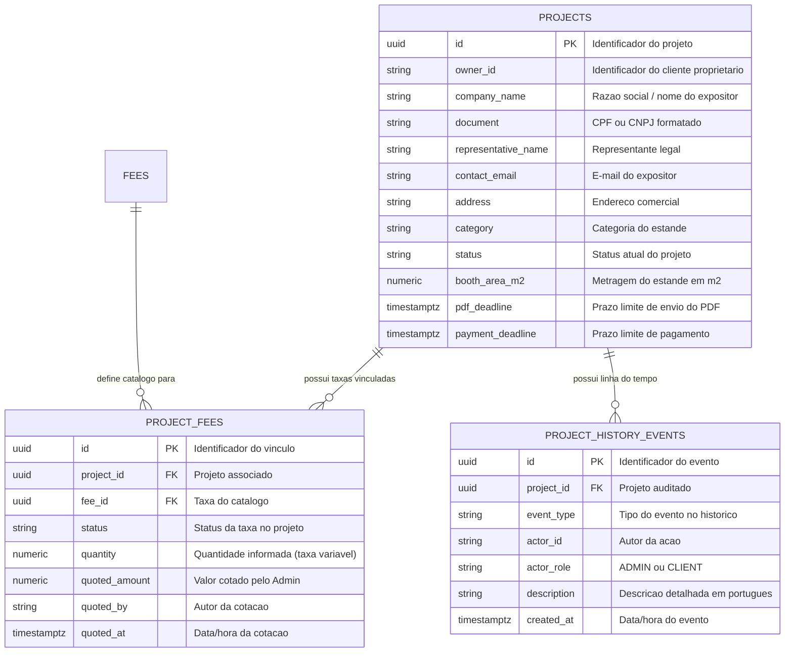

# RFC — US-17: Exportação do Histórico e Detalhes do Projeto em CSV

| | |
|---|---|
| **Status** | **Aprovada** |
| **Time / Autor** | João Pedro Leite Calsavara (@197837) |
| **Data** | 07/11/2026 |
| **Versão** | 1.0 |

---

## Contextualização

### Entendendo o problema
No gerenciamento operacional e financeiro do **SI600 Sistema de Eventos**, o `Administrador` frequentemente precisa realizar auditorias externas, conciliações contábeis e análises em planilhas (Microsoft Excel / LibreOffice Calc) sobre um `Projeto` específico. Atualmente, os dados cadastrais do projeto (empresa, CNPJ/CPF, representante, categoria, metragem, status e prazos), o detalhamento das `Taxa`s vinculadas (valores fixos, por metragem ou variáveis cotadas) e a linha do tempo de auditoria (`Histórico` — US-16) encontram-se distribuídos em telas e endpoints distintos na aplicação web.

Sem uma funcionalidade dedicada de exportação estruturada, o Administrador precisaria copiar manualmente informações de três visões diferentes, sujeitando a operação a erros de transcrição, perda de formatação de caracteres acentuados (UTF-8 no Excel em português) e incompatibilidade de delimitadores de coluna (já que o Excel configurado para o locale `pt-BR` utiliza o ponto e vírgula `;` como separador padrão em vez de vírgula).

### Explicando a solução de forma macro
A solução disponibiliza ao `Administrador` a exportação consolidada e sob demanda de todos os dados de um `Projeto` em um único arquivo CSV (`text/csv; charset=UTF-8`) através do endpoint `GET /projects/{projectId}/export/csv`.

O arquivo gerado pelo backend possui:
1. **Prefixo UTF-8 BOM (`\uFEFF`)**: Garante que o Microsoft Excel reconheça imediatamente a codificação UTF-8 ao abrir o arquivo com duplo clique, preservando todos os acentos da língua portuguesa.
2. **Separador Ponto e Vírgula (`;`) e Escape Seguro**: Compatível nativamente com o Excel em português, aplicando escape entre aspas duplas (`"..."`) e higienização contra *CSV Formula Injection* (`=`, `+`, `-`, `@` no início de textos livres) em campos textuais.
3. **Estrutura em 3 Seções com Cabeçalhos em Português**:
   - **Seção 1 — Dados Cadastrais do Projeto**: `ID do Projeto;Empresa;CPF/CNPJ;Representante;E-mail de Contato;Endereço;Categoria do Estande;Status do Projeto;Área do Estande (m²);Prazo de Envio do PDF;Prazo de Pagamento;Arquivo PDF;Decisão por;Data da Decisão;Justificativa de Reprovação`
   - **Seção 2 — Taxas do Projeto**: `ID do Vínculo;Nome da Taxa;Descrição;Tipo de Taxa;Status da Taxa;Quantidade;Unidade;Valor Calculado / Cotado (R$);Cotado por;Data da Cotação`
   - **Seção 3 — Histórico de Eventos**: `Data/Hora;Tipo de Evento;Autor;Perfil do Autor;Descrição`
4. **Download Automático no Navegador**: O endpoint retorna o cabeçalho `Content-Disposition: attachment; filename="projeto-<slug>-<id>.csv"`, e o frontend disponibiliza o botão **"Exportar em CSV"** tanto na coluna de ações da listagem de projetos (`ProjectListPage`) quanto no cabeçalho da visualização de histórico do projeto (`ProjectTimeline`, visível para o perfil `ADMIN`).

### Alternativas Descartadas e Trade-offs

1. **Geração do CSV exclusivamente no Frontend a partir do estado React em memória**
   - *Descarte*: Viola os Critérios de Aceite da US-17 ("o backend deve compilar os dados cadastrais, taxas e histórico em um arquivo CSV codificado em UTF-8 com separador de ponto e vírgula") e obrigaria o navegador a disparar múltiplas requisições encadeadas antes de montar o arquivo, além de falhar quando o projeto ainda não está com a tela de taxas carregada.
   - *Cenário viável*: Seria viável apenas para exportar uma tabela simples já inteiramente paginada e renderizada na tela.
2. **Tabela única achatada (denormalizada) repetindo todas as colunas do projeto em cada linha de taxa e histórico**
   - *Descarte*: Mistura entidades de cardinalidades e naturezas distintas ($1$ Projeto, $N$ Taxas, $M$ Eventos de Histórico) na mesma linha ou gera dezenas de células vazias por linha, prejudicando a leitura direta em auditorias no Excel.
   - *Cenário viável*: Seria vantajoso apenas se o arquivo fosse destinado à ingestão automatizada por um pipeline ETL relacional estrito em vez de auditoria humana no Excel.
3. **Restringir a exportação apenas a projetos com Planta Aprovada (`APROVADO` / `AGUARDANDO_PAGAMENTO` / `CONCLUIDO`)**
   - *Descarte*: Impediria o Administrador de auditar projetos em fase de análise ou reprovados (que já possuem dados cadastrais e histórico de submissões/reprovações relevantes). Compilar as taxas vinculadas independentemente do status da planta permite exportar o retrato fiel do projeto em qualquer momento do seu ciclo de vida.
   - *Cenário viável*: Seria aplicável caso o relatório fosse exclusivamente um demonstrativo financeiro de cobrança e não um relatório completo de auditoria do projeto.

---

## Implementação

### Diretriz Obrigatória de Testes
> [!IMPORTANT]
> **Padrão do Projeto: Apenas Testes de Integração e E2E (Sem Mocks Unitários)**
> Conforme definido nas [ADR 0001](file:///home/jpcalsavara/projetos/andamento/si600-web-petshop/docs/adr/0001-estrategia-de-testes-integracao-e-e2e.md) e [ADR 0002](file:///home/jpcalsavara/projetos/andamento/si600-web-petshop/docs/adr/0002-padroes-de-cenarios-de-teste-bons-ruins-incompletos.md):
> - Toda funcionalidade deve ser testada exclusivamente nos seams públicos (endpoints HTTP reais contra o banco de dados PostgreSQL de integração ou testes E2E no navegador). Mocks de banco ou de serviços internos são estritamente proibidos.
> - Toda suíte de testes deve cobrir a **Matriz Tripartite**:
>   1. **Casos Bons (Happy Path)**: exportação de projeto completo (com dados cadastrais, taxas fixas/por metragem/variáveis e eventos de histórico em ordem cronológica) e exportação de projeto recém-criado em `AGUARDANDO_PDF`, verificando status `200 OK`, `Content-Type: text/csv;charset=UTF-8`, `Content-Disposition: attachment`, presença de UTF-8 BOM, separador `;` e cabeçalhos em português.
>   2. **Casos Ruins (Sad Path / Regras de Negócio)**: tentativa de exportação por usuário com perfil `CLIENT` (`403 Forbidden`), tentativa sem cabeçalhos de autenticação (`401 Unauthorized`) e tentativa de exportar projeto inexistente (`404 Not Found`), garantindo resposta RFC 7807 e zero escrita suja no banco.
>   3. **Casos Incompletos (Boundary & Malformed Payloads)**: `projectId` malformado na URL (`400 Bad Request` com RFC 7807), tentativas de mutação (`POST`, `PUT`, `DELETE`) no endpoint de exportação (`405 Method Not Allowed`), e caracteres especiais (`;`, `"`, quebras de linha) nos dados do projeto devidamente escapados sem corromper as colunas do CSV.

---

### Rotas Propostas

| Método | Caminho | O que faz | Entrada (campos relevantes) | Saídas (status e códigos RFC 7807) |
|---|---|---|---|---|
| `GET` | `/projects/{projectId}/export/csv` | Compila dados cadastrais, taxas e histórico do projeto em arquivo CSV (`UTF-8` com `;`) exclusivo para `ADMIN` | `projectId` (UUID no path), headers de autenticação (`X-Authenticated-User-Id`, `X-Authenticated-User-Role: ADMIN`) | `200 OK` (`text/csv; charset=UTF-8` + `Content-Disposition: attachment`); `400 Bad Request` (UUID inválido); `401 Unauthorized`; `403 Forbidden` (Ator não é `ADMIN`); `404 Not Found` (Projeto não encontrado); `405 Method Not Allowed` |

---

### Banco de Dados (Diagrama ER)

A funcionalidade é estritamente de leitura (`@Transactional(readOnly = true)`) e consulta as tabelas consolidadas do domínio:



---

### Desenho de Fluxo da Rota (As Seis Perguntas Obrigatórias)

```mermaid
flowchart TD
    START((Inicio: GET /projects/{projectId}/export/csv)) --> VALIDATE_UUID{"1. projectId e um\nUUID valido?"}

    VALIDATE_UUID -- "Nao" --> ERR_400["Erro 400 Bad Request\n(RFC 7807 Invalid UUID)"]
    VALIDATE_UUID -- "Sim" --> CHECK_AUTH{"2. Ator autenticado\npossui perfil ADMIN?"}

    CHECK_AUTH -- "Nao (CLIENT)" --> ERR_403["Erro 403 Forbidden\n(Operacao exclusiva de Admin)"]
    CHECK_AUTH -- "Sim" --> CHECK_PROJECT{"3. Projeto existe\nno PostgreSQL?"}

    CHECK_PROJECT -- "Nao" --> ERR_404["Erro 404 Not Found\n(Projeto nao encontrado)"]
    CHECK_PROJECT -- "Sim" --> LOAD_DATA["4. Consultar em transacao readOnly:\n- Project (dados cadastrais)\n- ProjectFees + FeeCalculator (taxas)\n- ProjectHistoryEvents (historico cronologico)"]

    LOAD_DATA --> BUILD_CSV["5. Gerar payload CSV UTF-8 com BOM (\\uFEFF)\nseparado por ';' com cabecalhos em portugues"]
    BUILD_CSV --> SUCCESS((6. Sucesso: 200 OK\ntext/csv + Content-Disposition attachment))

    style ERR_400 fill:#ffcdd2,color:#b71c1c,stroke:#b71c1c
    style ERR_403 fill:#ffcdd2,color:#b71c1c,stroke:#b71c1c
    style ERR_404 fill:#ffcdd2,color:#b71c1c,stroke:#b71c1c
    style SUCCESS fill:#c8e6c9,color:#1b5e20,stroke:#1b5e20
    style START fill:#e0f2f1,color:#004d40,stroke:#004d40
```

---

### Fluxos Detalhados Textuais (Cobertura Tripartite ADR 0002)

#### 1. Casos Bons (Happy Path)
1. O Administrador clica em **"Exportar em CSV"** na listagem de projetos (`ProjectListPage`) ou dentro da visualização de histórico do projeto (`ProjectTimeline`).
2. O frontend realiza `GET /api/projects/{projectId}/export/csv` (com `responseType: 'blob'`).
3. O backend valida que o ator é `ADMIN`, carrega o `Project`, suas `ProjectFee`s ordenadas por nome da taxa (calculando valores de taxas fixas/por metragem quando a área do estande está disponível e exibindo valores cotados para variáveis) e seus `ProjectHistoryEvent`s em ordem cronológica (`createdAt ASC, sequenceOrder ASC`).
4. O backend monta o CSV em UTF-8 (iniciado por `\uFEFF`), separado por `;`, com cabeçalhos em português para as três seções (`DADOS DO PROJETO`, `TAXAS DO PROJETO`, `HISTÓRICO DE EVENTOS`), e retorna `200 OK` com `Content-Type: text/csv;charset=UTF-8` e `Content-Disposition: attachment; filename="projeto-<id>.csv"`.
5. O navegador inicia o download automático do arquivo `.csv`.

#### 2. Casos Ruins (Sad Path / Regras de Negócio)
1. **Acesso Negado para Cliente (`403 Forbidden`)**: Se um usuário com perfil `CLIENT` (mesmo sendo o proprietário do projeto) requisitar `GET /projects/{projectId}/export/csv`, o backend rejeita com `403 Forbidden` (RFC 7807), pois a exportação de auditoria em CSV é exclusiva do Administrador.
2. **Não Autenticado (`401 Unauthorized`)**: Requisições com header de perfil inválido ou ausente recebem `401 Unauthorized`.
3. **Projeto Inexistente (`404 Not Found`)**: Se `projectId` não existir no banco de dados, o backend retorna `404 Not Found` (RFC 7807).

#### 3. Casos Incompletos (Boundary & Malformed Payloads)
1. **UUID Malformado (`400 Bad Request`)**: Chamadas para `/projects/id-invalido/export/csv` retornam `400 Bad Request` estruturado via RFC 7807 e zero erro 500.
2. **Métodos HTTP de Escrita (`405 Method Not Allowed`)**: Chamadas `POST`, `PUT` ou `DELETE` para `/projects/{projectId}/export/csv` retornam `405 Method Not Allowed`.
3. **Escape de Caracteres Especiais no CSV**: Caso campos textuais do projeto (ex.: razão social, endereço, justificativa de reprovação ou descrição de taxa) contenham ponto e vírgula (`;`), aspas duplas (`"`) ou quebras de linha (`\n`, `\r`), o gerador envolve o campo em aspas duplas e duplica aspas internas (`""`), mantendo a integridade estrutural das colunas no Excel.

---

## Principal Desafio

- **Qual é:** Garantir compatibilidade imediata com o Microsoft Excel em português (codificação de acentos UTF-8 + delimitador `;` + proteção contra quebra de colunas e *CSV Injection*) mesmo quando o projeto está em estágios parciais do ciclo de vida (ex.: planta ainda sem área homologada ou taxas variáveis ainda não cotadas).
- **Por que é difícil:** O Excel no Windows/macOS em português interpreta arquivos `.csv` sem BOM como `Windows-1252`, corrompendo caracteres como `ç`, `ã`, `é` e `²`. Além disso, taxas do tipo `POR_METRAGEM` dependem de `boothAreaM2 > 0` para cálculo via `FeeCalculator`; se o projeto ainda estiver em `AGUARDANDO_PDF`, invocar `FeeCalculator.calculate` sem guarda lançaria `ApiException (422)`.
- **Como o desenho resolve:** O serviço `ProjectCsvExportService` prefixa o stream com o marcador UTF-8 BOM (`\uFEFF`), formata todas as células com escape RFC 4180 para o delimitador `;`, e verifica se `boothAreaM2 != null && boothAreaM2.signum() > 0` antes de calcular taxas por metragem (preenchendo `-` para valores pendentes de metragem ou cotação, sem lançar erro 422).

---

### Checklist de Execução (/to-ticket)

- [x] **1. Especificação e RFC (Docs-Driven ADR 0006)**:
  - [x] Elaborar e commitar `docs/rfc/US-17-exportacao-csv-projeto.md`.
- [x] **2. Testes de Integração Tripartite no Backend (TDD Red Phase)**:
  - [x] Criar `ProjectCsvExportIntegrationTest` cobrindo Casos Bons (projeto completo e projeto inicial), Casos Ruins (`401`, `403` para `CLIENT`, `404` projeto inexistente) e Casos Incompletos/Borda (`400` UUID inválido, `405` método inválido, escape de `;` e `"` em campos).
- [x] **3. Implementação Backend (Green Phase)**:
  - [x] Criar `ProjectCsvExportService` compilando dados cadastrais, taxas e histórico em CSV UTF-8 com BOM e separador `;`.
  - [x] Expor `GET /projects/{projectId}/export/csv` em `ProjectCsvExportController` com headers `Content-Type: text/csv;charset=UTF-8` e `Content-Disposition`.
- [x] **4. Implementação Frontend e Testes (React + Cypress)**:
  - [x] Adicionar `exportProjectCsv(projectId)` e helper de download em `frontend/src/services/api.ts`.
  - [x] Adicionar botão "Exportar em CSV" na listagem de projetos do Admin (`ProjectListPage.tsx`) e no cabeçalho de `ProjectTimeline.tsx` (quando Admin).
  - [x] Adicionar testes de contrato em `frontend/src/services/api.test.ts` e teste E2E em `frontend/cypress/e2e/project-history.cy.ts`.
- [x] **5. Validação Final (Quality Gate)**:
  - [x] Executar `./mvnw test` no backend e `npm run test` no frontend.
  - [x] Executar AI Gatekeeper Reviewer (`run_review.sh`).
