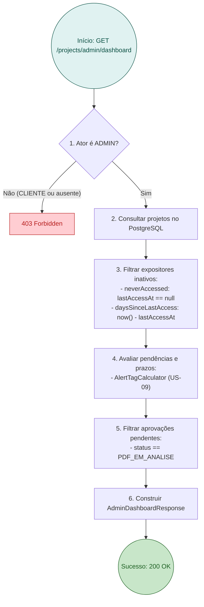

# RFC — US-18: Dashboard do Administrador

| | |
|---|---|
| **Status** | **Aprovada** |
| **Time / Autor** | João Pedro Leite Calsavara (@197837) |
| **Data** | 25/10/2026 |
| **Versão** | 1.0 |

---

## Contextualização

### Entendendo o problema
No modelo operacional do SI600 Web Eventos, o Administrador necessita monitorar continuamente múltiplos gargalos operacionais da feira: expositores que ainda não acessaram a plataforma para enviar plantas ou interagir com o sistema, projetos com prazos de envio de PDF ou pagamento próximos do vencimento ou vencidos, e arquivos de planta em formato PDF submetidos aguardando análise e aprovação técnica.

Atualmente, essas informações estão dispersas ou requerem navegações e filtragens manuais na listagem geral de projetos. A falta de uma visão consolidada e acionável em uma tela única retarda o processo decisório, impede intervenções proativas da organização junto aos expositores inativos e atrasa o fluxo de aprovação de plantas e emissão de cobranças.

### Explicando a solução de forma macro
A solução implementa o **Dashboard Principal do Administrador**, acessível pela rota de navegação "Resumo", consolidando as métricas e filas operacionais em três painéis integrados:
1. **Expositores Inativos**: exibe a informação de `ultimoAcesso` (em dias decorridos ou flag destacada em vermelho caso o cliente "Nunca acessou"), acompanhada da data de criação do projeto (`criadoEm` / `createdAt`).
2. **Projetos com Pendências e Prazos**: exibe projetos com suas respectivas tags de alerta (`ATRASADO`, `PRAZO_PROXIMO`, `PENDENTE`, `EM_DIA`), reaproveitando o cálculo dinâmico da US-09 (`AlertTagCalculator`).
3. **Aprovações Pendentes**: exibe a fila de projetos com plantas submetidas em status `PDF_EM_ANALISE`, com detalhes do arquivo e atalho de clique direto para a tela de análise/aprovação técnica (US-04/US-08).

Para suportar o primeiro painel com precisão, a entidade `Project` passa a rastrear a data/hora do último acesso do expositor (`lastAccessAt`), que é automaticamente atualizada quando o cliente consulta os detalhes de seu projeto (`GET /projects/{id}`).

### Alternativas Descartadas e Trade-offs

1. **Frontend realizar múltiplas requisições avulsas e filtrar no cliente**
   - *Descarte*: Obriga o frontend a baixar listas completas de projetos, recalcular filtros e agregações no navegador, além de multiplicar requisições HTTP desnecessariamente.
   - *Cenário viável*: Viável apenas em aplicações com baixíssimo volume de dados e sem separação de responsabilidade de regras agregadas no backend.
2. **Persistir as contagens e agregações em uma tabela estática de Dashboard**
   - *Descarte*: Como o estado dos projetos e o decurso do tempo mudam a cada minuto, tabelas de snapshot exigiriam rotinas contínuas de invalidação de cache ou triggers complexos de banco.
   - *Cenário viável*: Viável em plataformas de altíssima escala com data warehouses ou leitura OLAP assíncrona.
3. **Criar modelo completo de sessão e tabela de autenticação de usuários nesta US**
   - *Descarte*: O escopo da US-18 é focado na entrega do Dashboard operacional com base no modelo atual (`Actor`/`ownerId`). Criar tabelas de sessão extrapola os limites da US-18. Rastrear `lastAccessAt` diretamente em `Project` atende com precisão e simplicidade ao critério de aceite.
   - *Cenário viável*: Viável em uma demanda dedicada de autenticação OAuth2 / JWT multi-dispositivo.

---

## Implementação

### Diretriz Obrigatória de Testes
> [!IMPORTANT]
> **Padrão do Projeto: Apenas Testes de Integração e E2E (Sem Mocks Unitários)**
> Conforme definido nas [ADR 0001](file:///home/jpcalsavara/projetos/andamento/si600-web-petshop/docs/adr/0001-estrategia-de-testes-integracao-e-e2e.md) e [ADR 0002](file:///home/jpcalsavara/projetos/andamento/si600-web-petshop/docs/adr/0002-padroes-de-cenarios-de-teste-bons-ruins-incompletos.md):
> - Toda funcionalidade é testada nos seams públicos: endpoint HTTP com `@SpringBootTest` contra o banco PostgreSQL real.
> - Toda suíte de testes deve cobrir a **Matriz Tripartite**:
>   1. **Casos Bons (Happy Path)**: Retorno HTTP 200 contendo as três seções preenchidas corretamente, expositores inativos com dias calculados, expositor sem acesso marcado como "Nunca acessou", aprovações pendentes em `PDF_EM_ANALISE` e tags de prazo calculadas.
>   2. **Casos Ruins (Sad Path / Regras de Negócio)**: Requisições de clientes comuns ou atores não administradores respondem `403 Forbidden`.
>   3. **Casos Incompletos (Boundary & Malformed Payloads)**: Banco sem projetos retornando listas vazias íntegras (HTTP 200), projetos sem `lastAccessAt` retornando flag `neverAccessed: true`, projetos com acesso recente (0 dias).

---

### Rotas Afetadas / Propostas

| Método | Caminho | O que faz | Entrada | Saídas (status e payloads) |
|---|---|---|---|---|
| `GET` | `/projects/admin/dashboard` | Retorna o payload consolidado dos 3 painéis operacionais do Dashboard | Nenhuma (Header `X-Actor-Role: ADMIN` exigido) | `200 OK` (`AdminDashboardResponse`); `403 Forbidden` |
| `GET` | `/projects/{projectId}` | Consulta detalhes do projeto do Cliente e atualiza `lastAccessAt = now()` | `projectId` no path | `200 OK` (`ProjectResponse`); `404 Not Found`; `403 Forbidden` |

---

### Modelo de Dados e DTOs

#### Alterações na Entidade `Project`
```java
@Column(name = "last_access_at")
private OffsetDateTime lastAccessAt;

public void recordAccess(OffsetDateTime accessTime) {
    this.lastAccessAt = accessTime;
}
```

#### DTOs de Resposta do Dashboard
```java
public record InactiveExhibitorResponse(
    UUID projectId,
    String companyName,
    String representativeName,
    String contactEmail,
    OffsetDateTime createdAt,
    OffsetDateTime lastAccessAt,
    Long daysSinceLastAccess,
    boolean neverAccessed
) {}

public record PendingApprovalResponse(
    UUID projectId,
    String companyName,
    String pdfOriginalFilename,
    OffsetDateTime pdfUploadedAt,
    BigDecimal boothAreaM2,
    ProjectStatus status
) {}

public record AdminDashboardResponse(
    List<InactiveExhibitorResponse> inactiveExhibitors,
    List<ProjectResponse> pendingDeadlines,
    List<PendingApprovalResponse> pendingApprovals
) {}
```

---

### Desenho de Fluxo da Rota



---

### Fluxos Detalhados Textuais (Cobertura Tripartite ADR 0002)

#### 1. Casos Bons (Happy Path)
1. **Administrador acessa Dashboard**: Requisição com perfil `ADMIN` retorna HTTP 200 com os três blocos preenchidos.
2. **Identificação de "Nunca acessou"**: Projetos recém-cadastrados sem consulta do cliente retornam `neverAccessed: true` e `daysSinceLastAccess: null`.
3. **Cálculo de dias de inatividade**: Projeto com último acesso há 5 dias retorna `daysSinceLastAccess: 5` e `neverAccessed: false`.
4. **Fila de aprovações pendentes**: Projetos com `PDF_EM_ANALISE` listados com dados da planta e atalho direto.
5. **Tags de alerta consolidadas**: Projetos com prazos vencidos ou próximos listados com tags `ATRASADO` e `PRAZO_PROXIMO`.

#### 2. Casos Ruins (Sad Path / Regras de Negócio)
1. **Acesso por Cliente**: Cliente comum tenta chamar `GET /projects/admin/dashboard` e recebe `403 Forbidden`.
2. **Tentativa de acesso anônimo**: Requisição sem credencial ou role de admin recebe `403 Forbidden`.

#### 3. Casos Incompletos (Boundary & Malformed Payloads)
1. **Base de dados vazia**: Sem nenhum projeto cadastrado, o endpoint responde HTTP 200 com listas vazias `[]` sem lançar NPE.
2. **Acesso no mesmo dia (0 dias)**: Projeto acessado há poucas horas retorna `daysSinceLastAccess: 0` e `neverAccessed: false`.
3. **Projetos concluídos**: Projetos finalizados não poluem a lista de aprovações pendentes nem de alertas críticos.

---

### Principal Desafio

- **Qual é:** Integrar em um único seam público de leitura três filtros operacionais distintos (inatividade, análise de PDF e criticidade de prazos) de maneira performática e determinística no tempo.
- **Por que é difícil:** O cálculo de dias de inatividade e as tags de alerta dependem do relógio do sistema. Testes automatizados executados perto da virada do dia ou com relógio real podem gerar testes intermitentes (*flaky tests*).
- **Como o desenho resolve:** Injeção centralizada do bean `java.time.Clock` (`TimeHelper`), permitindo que a suíte de testes de integração fixe o tempo de forma imutável via `@TestConfiguration`, garantindo asserções exatas de dias de inatividade e tags de alerta.

---

### Checklist de Execução (/to-ticket)

- [ ] **1. RFC e Preparação da Branch**:
  - [x] Refinar requisitos da US-18 com o usuário via entrevista técnica (/grill-me).
  - [ ] Comitar `docs/rfc/US-18-dashboard-do-admin.md` como o primeiro commit da branch.
- [ ] **2. Incorporação de Prazos (Backend)**:
  - [ ] Incorporar `AlertTag`, `AlertTagCalculator`, `TimeHelper` e `TimeConfiguration` na branch.
  - [ ] Adicionar campo `lastAccessAt` em `Project.java` e método `recordAccess()`.
  - [ ] Atualizar `ProjectPdfService.getClientProject` para registrar acesso ao consultar projeto.
- [ ] **3. Endpoints e DTOs do Dashboard (Backend)**:
  - [ ] Criar DTOs `InactiveExhibitorResponse`, `PendingApprovalResponse` e `AdminDashboardResponse`.
  - [ ] Criar método `getAdminDashboard()` em `ProjectService` / `ProjectPdfService`.
  - [ ] Expor endpoint `GET /projects/admin/dashboard` em `ProjectPdfController`.
- [ ] **4. Testes de Integração Tripartite (Backend)**:
  - [ ] Criar `AdminDashboardIntegrationTest` cobrindo Happy Path, Forbidden (Sad) e Casos Limítrofes (Incompletos).
  - [ ] Validar que todos os testes passam via `./mvnw test`.
- [ ] **5. Interface do Dashboard (Frontend React/Vite)**:
  - [ ] Criar tipos em `src/types/index.ts` para o Dashboard.
  - [ ] Criar serviço de API para o Dashboard em `src/services/adminDashboard.ts` ou `api.ts`.
  - [ ] Criar componente `AdminDashboardPage` e estilização SCSS moderna:
    - Painel 1: Expositores Inativos com tag vermelha para "Nunca acessou" e data de criação.
    - Painel 2: Projetos com Pendências e Prazos com tags visuais de alerta.
    - Painel 3: Aprovações Pendentes com atalho direto para a tela de análise de PDF.
  - [ ] Integrar `AdminDashboardPage` na navegação do `App.tsx` (seção `resumo`).
- [ ] **6. Testes Frontend e E2E**:
  - [ ] Criar testes unitários/componente com Vitest.
  - [ ] Criar teste de jornada E2E no Cypress validando o Dashboard do Admin.
- [ ] **7. Validação do Quality Gate (Gatekeeper)**:
  - [ ] Executar `./mvnw test` e `npm test`.
  - [ ] Executar script do AI Gatekeeper (`run_review.sh`).
