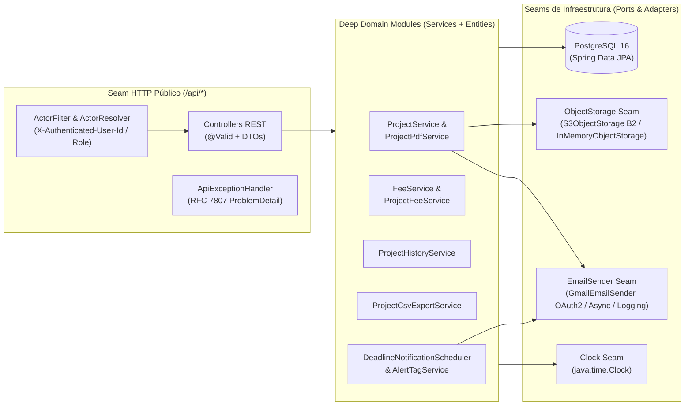
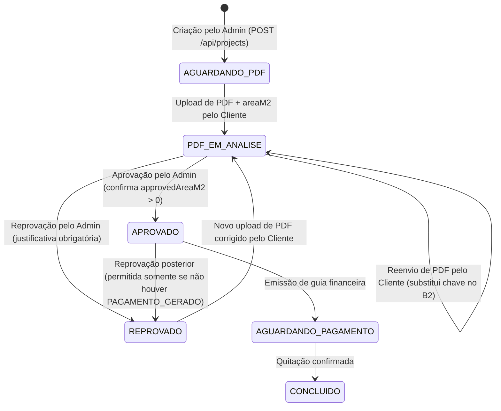

# RFC Geral do Backend — Arquitetura, Seams, Contratos REST e MER Consolidado

- **Autor(es):** Equipe SI600 Web Eventos
- **Data:** 2026-11-08
- **Status:** Implementado / Vigente

---

## 1. Contexto e Motivação

O backend do **SI600 Sistema de Eventos** concentra a autoridade transacional e as regras de negócio para o ciclo de vida completo de locação e montagem de estandes em feiras e eventos. Ele atende dois perfis de atores:

1. **Cliente (`CLIENT` / Expositor):** Visualiza seu `Projeto`, submete a `Planta` arquitetônica do estande em formato PDF informando a metragem pretendida (`areaM2`), acompanha a decisão de aprovação/reprovação, preenche quantidades de taxas variáveis (`Taxa` do tipo `VARIAVEL`), visualiza os valores calculados das taxas após a aprovação da planta e consulta a linha do tempo de auditoria.
2. **Administrador (`ADMIN` / Organização do Evento):** Gerencia o catálogo global de taxas (`Fee`), cadastra projetos de expositores (`Project`), configura quais taxas incidem sobre cada projeto (`ProjectFee`), analisa e aprova/reprova plantas PDF (confirmando a metragem oficial `approvedAreaM2` ou exigindo justificativa de reprovação), fornece cotações financeiras para taxas variáveis, acompanha indicadores operacionais e gargalos no Dashboard Kanban, e exporta relatórios consolidados em CSV.

Esta RFC unifica a especificação arquitetural do backend, seus seams de infraestrutura, invariantes de domínio, contratos HTTP REST (`/api/...`), tratamento de erros segundo a RFC 7807 (`ProblemDetail`) e o **Modelo Entidade-Relacionamento (MER) final** em Mermaid.

---

## 2. Arquitetura de Módulos Profundos e Seams de Infraestrutura

Seguindo os princípios de **Deep Modules** (`/codebase-design`), o backend expõe interfaces enxutas nas bordas HTTP e encapsula toda a complexidade de validação, cálculo financeiro, transições de estado, auditoria e integrações externas atrás de seams bem definidos:

### 2.1 Seams e Adaptadores Reais (Two-Adapter Rule)

Cada seam externo possui ao menos dois adaptadores reais (produção e substituto local/teste), permitindo testes de integração determinísticos sem mocks de banco de dados ([ADR 0001](../adr/0001-estrategia-de-testes-integracao-e-e2e.md)):

| Seam (Interface) | Adaptador de Produção | Adaptador Local / Teste | Responsabilidade |
| :--- | :--- | :--- | :--- |
| **`ObjectStorage`** | `S3ObjectStorage` (Backblaze B2 via protocolo S3 compatível, [ADR 0004](../adr/0004_armazenamento_b2_para_pdfs_de_estande.md)) | `InMemoryObjectStorage` | Armazenamento privado de arquivos PDF (limite de 10 MB, validação de magic bytes `%PDF-`), remoção de chaves substituídas e geração de URLs assinadas temporárias (15 min). |
| **`EmailSender`** | `AsyncEmailSender` + `GmailEmailSender` (API REST Gmail OAuth2 via JDK `HttpClient`) | `LoggingEmailSender` / `RecordingEmailSender` | Disparo assíncrono de notificações de decisão de planta (aprovação/reprovação) e alertas automáticos de vencimento de prazos (`T-7`, `T-3`, `T-1`, `T0`, `T+1`). |
| **`Clock`** | `Clock.systemUTC()` (`TimeConfiguration`) | `MutableClock` / `Clock.fixed(...)` | Determinismo temporal para cálculo dinâmico de `AlertTag` e disparo do agendador diário de notificações de prazo. |
| **`ActorResolver`** | `ActorFilter` (extração dos cabeçalhos `X-Authenticated-User-Id` e `X-Authenticated-User-Role`) | Cabeçalhos injetados por `MockMvc` / Cypress | Isolamento da identidade autenticada (`ADMIN` vs `CLIENT`) e verificação estrita de propriedade (`project.ownerId == actor.id`). |

---

## 3. Modelo Entidade-Relacionamento (MER) Final

O esquema relacional consolidado no PostgreSQL 16 (`eventos_db`) é composto por **5 tabelas principais** mapeadas pelas entidades JPA em `br.unicamp.ft.si600.eventos.entity`:

```mermaid
erDiagram
    PROJECTS ||--o{ PROJECT_FEES : "possui taxas vinculadas (1:N)"
    FEES ||--o{ PROJECT_FEES : "define modelo de taxa (1:N)"
    PROJECTS ||--o{ PROJECT_HISTORY_EVENTS : "registra trilha de auditoria (1:N)"
    PROJECTS ||--o{ DEADLINE_NOTIFICATIONS : "controla idempotencia de alertas (1:N)"

    PROJECTS {
        uuid id PK "Identificador único do projeto"
        varchar(100) owner_id "ID do Cliente proprietário (idx_projects_owner_id)"
        varchar(200) company_name "Razão social ou nome da empresa expositora"
        varchar(30) document "CPF ou CNPJ formatado"
        varchar(14) document_digits UK "Apenas dígitos do CPF/CNPJ (único)"
        varchar(200) representative_name "Nome do representante responsável"
        varchar(100) category "Categoria do estande/expositor"
        varchar(300) address "Endereço comercial do expositor"
        varchar(254) contact_email UK "E-mail de contato e notificações (único)"
        timestamptz pdf_deadline "Prazo limite para envio da planta PDF"
        timestamptz payment_deadline "Prazo limite para pagamento das taxas"
        varchar(40) status "AGUARDANDO_PDF | PDF_EM_ANALISE | REPROVADO | APROVADO | AGUARDANDO_PAGAMENTO | CONCLUIDO"
        numeric(12_2) booth_area_m2 "Área do estande em m² (informada no upload e confirmada na aprovação)"
        varchar(500) pdf_object_key "Chave do arquivo PDF no Backblaze B2"
        varchar(255) pdf_original_filename "Nome original do arquivo PDF enviado"
        varchar(100) pdf_content_type "MIME type validado (application/pdf)"
        bigint pdf_size_bytes "Tamanho do PDF em bytes (máx. 10 MB)"
        timestamptz pdf_uploaded_at "Data/hora do último envio do PDF"
        varchar(100) decision_by "ID do Administrador que aprovou ou reprovou"
        timestamptz decision_at "Data/hora da decisão administrativa"
        text rejection_justification "Motivo obrigatório em caso de reprovação"
        varchar(100) created_by "ID do Administrador que criou o projeto"
        timestamptz created_at "Data/hora de criação do projeto"
        timestamptz last_access_at "Último acesso registrado do Cliente ao projeto"
    }

    FEES {
        uuid id PK "Identificador único da taxa no catálogo"
        varchar(200) name "Nome da taxa (único entre taxas ativas, case-insensitive)"
        varchar(2000) description "Descrição detalhada da taxa"
        varchar(30) type "FIXA | POR_METRAGEM | VARIAVEL"
        boolean active "Indica se a taxa está ativa no catálogo"
        varchar(40) area_pricing_mode "VALOR_POR_M2 | UNIDADES_POR_INTERVALO (quando POR_METRAGEM)"
        numeric(14_2) amount "Valor fixo em R$ (quando FIXA)"
        numeric(14_2) amount_per_m2 "Valor por m² em R$ (quando VALOR_POR_M2)"
        numeric(12_2) area_per_unit_m2 "Intervalo de área em m² por unidade (quando UNIDADES_POR_INTERVALO)"
        numeric(14_2) unit_amount "Valor por unidade de intervalo em R$ (quando UNIDADES_POR_INTERVALO)"
        varchar(100) measurement_unit "Unidade de medida ex: un, kVA, pontos (quando VARIAVEL)"
    }

    PROJECT_FEES {
        uuid id PK "Identificador único do vínculo Projeto-Taxa"
        uuid project_id FK "Referência a projects.id (uk_project_fees_project_fee)"
        uuid fee_id FK "Referência a fees.id (uk_project_fees_project_fee)"
        varchar(40) status "DISPONIVEL | AGUARDANDO_QUANTIDADE | AGUARDANDO_COTACAO | COTADA | PAGAMENTO_GERADO"
        numeric(12_2) quantity "Quantidade informada pelo Cliente (quando VARIAVEL)"
        timestamptz quantity_updated_at "Data/hora de preenchimento da quantidade"
        numeric(12_2) quoted_amount "Valor cotado pelo Administrador em R$ (quando VARIAVEL)"
        varchar(200) quoted_by "ID do Administrador que realizou a cotação"
        timestamptz quoted_at "Data/hora da cotação"
    }

    PROJECT_HISTORY_EVENTS {
        uuid id PK "Identificador único do evento de histórico"
        uuid project_id FK "Referência lógica a projects.id (idx_project_history_events_project_id)"
        varchar(50) event_type "PROJETO_CRIADO | PDF_ENVIADO | PDF_APROVADO | PDF_REPROVADO | TAXAS_CONFIGURADAS | QUANTIDADE_INFORMADA | TAXA_COTADA"
        varchar(200) actor_id "Identificador do autor da ação"
        varchar(30) actor_role "ADMIN | CLIENT"
        varchar(500) description "Descrição legível da transição ou evento"
        timestamptz created_at "Instante exato do evento"
        bigint sequence_order "Ordem monotônica para desempate determinístico"
    }

    DEADLINE_NOTIFICATIONS {
        uuid id PK "Identificador único do registro de envio"
        uuid project_id FK "Referência lógica a projects.id (idx_deadline_notifications_project_id)"
        varchar(40) deadline_type "PDF_SUBMISSION | PAYMENT"
        varchar(40) milestone "DAYS_BEFORE_7 | DAYS_BEFORE_3 | DAYS_BEFORE_1 | DUE_TODAY | OVERDUE_1"
        date deadline_date "Data do prazo vigente no momento do disparo"
        varchar(254) recipient "E-mail destinatário (Cliente ou Admin)"
        timestamptz sent_at "Data/hora de confirmação do envio (uk_deadline_notifications_milestone)"
    }
```

---

## 4. Regras de Negócio e Máquinas de Estado

### 4.1 Ciclo de Vida do Projeto (`ProjectStatus`)

### 4.2 Regras de Cálculo e Ciclo de Vida das Taxas do Projeto (`ProjectFeeStatus`)

1. **Bloqueio Pré-Aprovação:** Enquanto `project.status` não estiver em `{APROVADO, AGUARDANDO_PAGAMENTO, CONCLUIDO}`, o endpoint `GET /api/projects/{projectId}/fees` retorna `HTTP 409 Conflict` para o Cliente.
2. **Modalidades de Cálculo (`FeeType`):**
   - **`FIXA`:** Nasce com status `DISPONIVEL`. Valor calculado = `fee.amount`.
   - **`POR_METRAGEM`:** Nasce com status `DISPONIVEL`. Depende de `project.boothAreaM2 > 0`:
     - Modo `VALOR_POR_M2`: $\text{total} = \text{round\_half\_up}(\text{boothAreaM2} \times \text{amountPerM2}, 2)$.
     - Modo `UNIDADES_POR_INTERVALO`: $\text{unidades} = \lceil \text{boothAreaM2} / \text{areaPerUnitM2} \rceil$, e $\text{total} = \text{round\_half\_up}(\text{unidades} \times \text{unitAmount}, 2)$.
   - **`VARIAVEL`:**
     - Nasce em `AGUARDANDO_QUANTIDADE` (`calculatedAmount = null`).
     - Quando o Cliente salva a quantidade (`PUT /api/projects/{projectId}/fees/{projectFeeId}/quantity`), a entidade limpa qualquer cotação anterior (`quotedAmount = null`, `quotedBy = null`, `quotedAt = null`) e transita para `AGUARDANDO_COTACAO`.
     - Quando o Administrador informa o valor (`PUT /api/projects/{projectId}/fees/{projectFeeId}/quote`), o status transita para `COTADA` e `calculatedAmount = quotedAmount`.
     - Se `status == PAGAMENTO_GERADO`, alterações de quantidade, remoção da taxa na configuração ou nova cotação são bloqueadas com `HTTP 409 Conflict`.

### 4.3 Tags Dinâmicas de Alerta (`AlertTag`)

Calculadas em tempo de leitura por `AlertTagService` usando o `Clock` injetado (fuso `America/Sao_Paulo`, sem persistência redundante em banco):
1. **`CONCLUIDO`**: `status == CONCLUIDO` (retorna apenas `[CONCLUIDO]`).
2. **Prazo Relevante**:
   - Se `status in {AGUARDANDO_PDF, PDF_EM_ANALISE, REPROVADO}` -> avalia `pdfDeadline`.
   - Se `status in {APROVADO, AGUARDANDO_PAGAMENTO}` -> avalia `paymentDeadline`.
   - `hoje > prazo` -> **`ATRASADO`**; `0 <= dias <= 7` -> **`PRAZO_PROXIMO`**.
3. **Pendência Operacional**:
   - Se `status != APROVADO` ou existir qualquer `ProjectFee` do projeto com status diferente de `PAGAMENTO_GERADO` -> adiciona **`PENDENTE`**.
4. **`EM_DIA`**: Atribuída exclusivamente quando nenhuma das tags acima se aplica.

---

## 5. Catálogo de Endpoints REST (`/api`)

Todos os controllers respondem sob o context-path `/api` (`server.servlet.context-path=/api`). Erros de validação (`400`), autenticação/autorização (`401`/`403`), recurso inexistente (`404`), conflito de estado (`409`) e regra semântica (`422`) seguem estritamente o formato **RFC 7807 (`application/problem+json`)** produzido por `ApiExceptionHandler`.

### 5.1 Saúde e Catálogo de Taxas (`HealthController`, `FeeController`)

| Método | Rota | Papel | Descrição |
| :--- | :--- | :--- | :--- |
| `GET` | `/api/health` | Público | Verifica disponibilidade da API (`status: UP`). |
| `GET` | `/api/fees` | `ADMIN` / `CLIENT` | Lista todas as taxas ativas ordenadas por nome. |
| `GET` | `/api/fees/{id}` | `ADMIN` / `CLIENT` | Detalha uma taxa ativa pelo UUID. |
| `POST` | `/api/fees` | `ADMIN` | Cria taxa (`FIXA`, `POR_METRAGEM` ou `VARIAVEL`); `409` se nome duplicado ativo. |
| `PUT` | `/api/fees/{id}` | `ADMIN` | Atualiza taxa existente; `409` se conflitar com nome de outra taxa ativa. |
| `POST` | `/api/fees/{id}/deactivate` | `ADMIN` | Desativa logicamente a taxa (`active = false`). |

### 5.2 Projetos, Plantas PDF e Dashboard (`ProjectPdfController`)

| Método | Rota | Papel | Descrição |
| :--- | :--- | :--- | :--- |
| `POST` | `/api/projects` | `ADMIN` | Cria projeto expositor, vincula `feeIds` iniciais (`ProjectFee`) e grava `PROJETO_CRIADO`. Valida unicidade de CPF/CNPJ e e-mail (`409`) e `paymentDeadline >= pdfDeadline` (`422`). |
| `GET` | `/api/projects/{projectId}` | `CLIENT` (dono) / `ADMIN` | Retorna dados do projeto e `alertTags`; atualiza `lastAccessAt` quando acessado pelo Cliente dono. |
| `POST` | `/api/projects/{projectId}/pdf` | `CLIENT` (dono) | Multipart (`file` PDF até 10 MB + `areaM2 > 0`). Grava objeto no B2, atualiza `status = PDF_EM_ANALISE` e registra `PDF_ENVIADO`. |
| `GET` | `/api/projects/{projectId}/pdf/download` | `CLIENT` (dono) / `ADMIN` | Retorna URL assinada temporária (`DownloadUrlResponse`) com validade de 15 minutos. |
| `GET` | `/api/projects/admin` | `ADMIN` | Lista todos os projetos (com filtro opcional `?status=`). |
| `GET` | `/api/projects/admin/dashboard` | `ADMIN` | Retorna indicadores do Dashboard Admin: contagens por `ProjectStatus`, listas de aprovações pendentes, cotações pendentes e expositores inativos (`>= 7` dias sem acesso). |
| `POST` | `/api/projects/admin/{projectId}/approve` | `ADMIN` | Aprova planta (`approvedAreaM2 > 0`), transita para `APROVADO`, registra `PDF_APROVADO` e dispara e-mail ao expositor. |
| `POST` | `/api/projects/admin/{projectId}/reject` | `ADMIN` | Reprova planta (`justification` obrigatória), bloqueia se houver `PAGAMENTO_GERADO` (`409`), registra `PDF_REPROVADO` e dispara e-mail ao expositor. |

### 5.3 Taxas do Projeto, Cotações, Histórico e Exportação CSV (`ProjectFeeController`, `AdminQuoteController`, `ProjectHistoryController`, `ProjectCsvExportController`)

| Método | Rota | Papel | Descrição |
| :--- | :--- | :--- | :--- |
| `GET` | `/api/projects/{projectId}/fees` | `CLIENT` (dono) / `ADMIN` | Lista taxas calculadas do projeto (exige planta aprovada; caso contrário `409`). |
| `GET` | `/api/projects/{projectId}/fees/configuration` | `ADMIN` | Lista o catálogo ativo indicando quais taxas estão associadas ao projeto e quais estão bloqueadas (`PAGAMENTO_GERADO`). |
| `PUT` | `/api/projects/{projectId}/fees/configuration` | `ADMIN` | Sincroniza o conjunto de `feeIds` do projeto em transação única e registra `TAXAS_CONFIGURADAS`. |
| `PUT` | `/api/projects/{projectId}/fees/{projectFeeId}/quantity` | `CLIENT` (dono) | Salva quantidade (`quantity > 0`) de taxa `VARIAVEL`, limpa cotação anterior, muda status para `AGUARDANDO_COTACAO` e registra `QUANTIDADE_INFORMADA`. |
| `GET` | `/api/admin/quotes` | `ADMIN` | Lista fila de taxas variáveis de projetos aprovados em `AGUARDANDO_COTACAO` ou `COTADA`. |
| `PUT` | `/api/projects/{projectId}/fees/{projectFeeId}/quote` | `ADMIN` | Registra cotação financeira (`quotedAmount > 0`), muda status para `COTADA` e registra `TAXA_COTADA`. |
| `GET` | `/api/projects/{projectId}/history` | `CLIENT` (dono) / `ADMIN` | Retorna linha do tempo (`ProjectHistoryEventResponse`) ordenada cronologicamente. Para `CLIENT`, `actorId` é mascarado (`null`), expondo apenas `actorRole`. |
| `GET` | `/api/projects/{projectId}/export/csv` | `ADMIN` | Gera arquivo `text/csv; charset=UTF-8` com BOM UTF-8, metadados do projeto, detalhamento das taxas, total calculado e proteção contra CSV Formula Injection. |

---

## 6. Estratégia de Testes de Integração (ADR 0001 e ADR 0002)

Todas as suítes em `backend/src/test/java/br/unicamp/ft/si600/eventos/` executam com `@SpringBootTest` + `@AutoConfigureMockMvc` contra banco relacional real e os adaptadores determinísticos de teste (`InMemoryObjectStorage`, `RecordingEmailSender`, `MutableClock`), cobrindo obrigatoriamente a matriz tripartite:
- **Casos Bons (Happy Path):** Criação, listagem, cálculo aritmético exato, persistência no banco, eventos de histórico e envio de e-mails/objetos S3.
- **Casos Ruins (Sad Path):** Violação de propriedade (`403`), projeto/taxa inexistente (`404`), conflito de estado ou unicidade (`409`), prazos invertidos (`422`) com garantia de rollback transacional.
- **Casos Incompletos (Malformed / Boundary):** Payloads nulos, listas vazias, números negativos/zero, arquivos falsos sem assinatura `%PDF-` ou acima de 10 MB (`400`/`413`) retornando matriz `errors` na estrutura RFC 7807 sem jamais produzir `500 Internal Server Error`.
