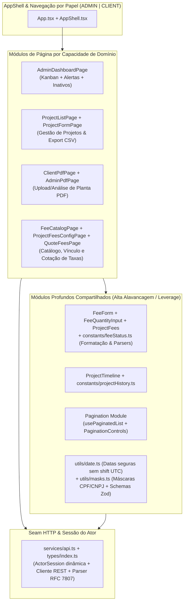

# RFC Geral do Frontend — Arquitetura de Módulos Profundos, Seams e Testes E2E

- **Autor(es):** Equipe SI600 Web Eventos
- **Data:** 2026-11-08
- **Status:** Implementado / Vigente

---

## 1. Contexto e Decisão Arquitetural: Por que Módulos Profundos de Domínio em vez de Atomic Design?

O frontend do **SI600 Sistema de Eventos** é uma Single Page Application (SPA) construída com **React 18, TypeScript, Vite, SCSS Modules, Axios e Zod**.

Durante a revisão arquitetural (`/improve-codebase-architecture`), avaliamos a adoção de **Atomic Design** (`atoms/`, `molecules/`, `organisms/`, `templates/`, `pages/`) frente ao design de **Deep Modules** orientados ao domínio ([SKILL.md](../../.agents/skills/codebase-design/SKILL.md)).

### 1.1 Rejeição do Atomic Design pelo Deletion Test e Locality

O Atomic Design foi **rejeitado** pelos seguintes motivos técnicos:
1. **Proliferação de Módulos Rasos (Shallow Modules):** Particionar formulários e tabelas de domínio em átomos (`Input`, `Badge`, `Button`) e moléculas (`LabeledInput`, `FeeRow`) cria camadas intermediárias cuja **interface** (dezenas de props repassadas como `value`, `onChange`, `error`, `disabled`, `data-testid`) é tão complexa quanto sua **implementation**.
2. **Falha no Deletion Test:** Remover wrappers atômicos de pass-through não espalha complexidade nos chamadores; pelo contrário, elimina prop-drilling desnecessário.
3. **Destruição de Locality:** Uma única regra de domínio — como a formatação e validação de uma `Taxa` ou a transição de uma `Planta` — ficaria espalhada em 5 níveis de diretórios visuais (`atoms` -> `molecules` -> `organisms` -> `templates` -> `pages`), dificultando a manutenção humana e a navegação por agentes de IA.

### 1.2 Arquitetura Adotada: Deep Domain Modules + Seams Coesos

Adotamos módulos profundos alinhados à linguagem ubíqua de [CONTEXT.md](../../CONTEXT.md), onde cada módulo esconde validação, formatação, paginação e orquestração de estado atrás de uma interface pequena:

---

## 2. Principais Seams e Módulos do Frontend

### 2.1 Seam de Sessão e Comunicação HTTP (`src/services/api.ts` e `src/types/index.ts`)

- **Resolução Dinâmica de Sessão (`ActorSession`):** As funções `getCurrentActorRole()`, `getCurrentActorId()` e `getCurrentClientProjectId()` consultam `window.localStorage` (`MOCK_ROLE`, `MOCK_ACTOR_ID`, `MOCK_PROJECT_ID`) com fallback para variáveis de ambiente (`VITE_USER_ROLE`, `VITE_USER_ID`, `VITE_PROJECT_ID`) **dinamicamente a cada chamada e em cada requisição Axios**. Isso permite alternar entre os papéis `ADMIN` e `CLIENT` em tempo de execução e durante os testes E2E sem recarregamento forçado de módulo.
- **Normalização de Erros RFC 7807 (`ApiRequestError`):** O interceptor de erro traduz respostas `ProblemDetail` (`title`, `detail`, `status`, `errors`) em instâncias tipadas de `ApiRequestError`, permitindo que páginas e formulários exibam tanto mensagens gerais de conflito (`409`/`422`) quanto erros específicos por campo (`fieldErrors`).
- **Contratos Unificados (`src/types/index.ts`):** Concentra todas as interfaces de domínio (`Fee`, `Project`, `ProjectFee`, `CalculatedFee`, `QuoteableProjectFee`, `ProjectFeeConfiguration`, `ProjectHistoryEvent`, `AdminDashboardData`, `AlertTag`), eliminando tipos duplicados ou espalhados.

### 2.2 Módulo de Domínio de Taxas (`src/constants/feeStatus.ts`, `FeeForm`, `FeeQuantityInput`)

Concentra em um único ponto de **locality**:
1. **Formatação Canônica de Preços (`formatFeePricing(fee)`):** Formata de maneira consistente as três modalidades (`FIXA`, `VARIAVEL` com `measurementUnit`, e `POR_METRAGEM` tanto no modo `VALOR_POR_M2` quanto `UNIDADES_POR_INTERVALO`), servindo simultaneamente `FeeCatalogPage` e `ProjectFeesConfigPage`.
2. **Parsers de Entrada (`parseQuantity` e `parseQuoteAmount`):** Validam entradas numéricas com suporte a vírgula decimal pt-BR, limites máximos e restrição de inteiros quando a unidade é `un`/`unidade`/`unidades`.
3. **Validação com Zod (`validateFeeFormWithZod` em `src/utils/masks.ts`):** Valida invariantes cruzadas do formulário de taxa antes do envio HTTP e normaliza espaços/caracteres de controle.

### 2.3 Módulo de Paginação (`src/components/Pagination/Pagination.tsx`)

O hook `usePaginatedList(items, pageSize)` e o componente `<PaginationControls />` encapsulam:
- Cálculo de `totalPages = Math.max(1, Math.ceil(items.length / pageSize))`;
- Clamping automático de `currentPage` (`Math.min(currentPage, totalPages)`) quando filtros ou aprovações reduzem o tamanho da coleção;
- Fatiamento (`paginatedItems`) e controles acessíveis (`Anterior` / `Próxima`) reutilizados nas 6 listagens administrativas (`AdminDashboardPage` x3, `ProjectListPage`, `FeeCatalogPage`, `AdminPdfPage`, `ProjectFeesConfigPage`).

### 2.4 Módulo de Datas sem Deslocamento de Fuso (`src/utils/date.ts`)

- `formatDate(isoDateStr)`: Extrai diretamente `YYYY-MM-DD` de strings ISO antes da formatação `dd/mm/aaaa`, evitando que `new Date('YYYY-MM-DD')` desloque a data em -1 dia no fuso `America/Sao_Paulo` (UTC-3).
- `formatDateTime(isoDateStr)`: Formata carimbos de data/hora completos em `pt-BR` para histórico (`ProjectTimeline`) e auditoria de PDF (`AdminPdfPage`, `ClientPdfPage`).

---

## 3. Mapa de Páginas e Jornadas de Usuário

| Página | Rota / Aba | Papel | Endpoint(s) Consumidos | Responsabilidade Principal |
| :--- | :--- | :--- | :--- | :--- |
| **`AdminDashboardPage`** | Aba `Dashboard` | `ADMIN` | `GET /api/projects/admin/dashboard` | Visão gerencial em Kanban por `ProjectStatus`, alertas de aprovações pendentes, cotações pendentes e expositores inativos (`>= 7` dias). |
| **`ProjectListPage`** | Aba `Projetos` | `ADMIN` | `GET /api/projects/admin`, `GET /api/projects/{id}/export/csv` | Listagem paginada de projetos com busca por empresa/CNPJ/representante, filtro por status, tags de alerta, modal de histórico e download de relatório CSV. |
| **`ProjectFormPage`** | Modal / Formulário em `Projetos` | `ADMIN` | `POST /api/projects`, `GET /api/fees` | Cadastro de novo projeto expositor com máscara de CPF/CNPJ, validação Zod, definição de prazos e seleção inicial de taxas. |
| **`ProjectFeesConfigPage`** | Ação `Configurar Taxas` em `Projetos` | `ADMIN` | `GET` e `PUT /api/projects/{id}/fees/configuration` | Associação e desassociação de taxas do catálogo a um projeto específico, bloqueando remoção de taxas com `PAGAMENTO_GERADO`. |
| **`AdminPdfPage`** | Aba `Análise de PDFs` | `ADMIN` | `GET /api/projects/admin`, `GET /api/projects/{id}/pdf/download`, `POST .../approve`, `POST .../reject` | Fila de análise de plantas com download via URL assinada, aprovação com confirmação de `approvedAreaM2` e reprovação com justificativa obrigatória. |
| **`QuoteFeesPage`** | Aba `Cotar Taxas` | `ADMIN` | `GET /api/admin/quotes`, `PUT /api/projects/{id}/fees/{pfId}/quote` | Fila de cotação e recotação financeira das taxas variáveis cuja quantidade já foi informada pelo expositor. |
| **`FeeCatalogPage`** | Aba `Catálogo de Taxas` | `ADMIN` | `GET /api/fees`, `POST /api/fees`, `PUT /api/fees/{id}`, `POST /api/fees/{id}/deactivate` | CRUD completo e desativação lógica do catálogo de taxas do evento. |
| **`ClientPdfPage` + `ProjectFees`** | Visão do Expositor | `CLIENT` | `GET /api/projects/{id}`, `POST /api/projects/{id}/pdf`, `GET /api/projects/{id}/fees`, `PUT .../quantity`, `GET .../history` | Painel do expositor: status e tags de alerta, upload/reenvio de planta PDF com metragem, tabela de taxas calculadas (liberada após aprovação), envio de quantidade de taxas variáveis e linha do tempo do projeto. |

---

## 4. Padronização e Estratégia de Testes (ADR 0001, ADR 0002 e ADR 0005)

1. **Qualidade Estática ([ADR 0005](../adr/0005-padronizacao-de-codigo-com-eslint-e-prettier.md)):** Scripts `npm run lint` (ESLint) e `npm run format:check` (Prettier) garantem consistência de código TypeScript/React e SCSS Modules.
2. **Testes nos Seams Públicos ([ADR 0001](../adr/0001-estrategia-de-testes-integracao-e-e2e.md)):**
   - **Proibição de Mocks Artificiais:** Nenhum teste utiliza `vi.mock('axios')` ou `cy.intercept` estático para simular o backend.
   - **Suíte E2E Cypress (`frontend/cypress/e2e/*.cy.ts`):** Exercita a aplicação real no navegador conectada ao backend Spring Boot e PostgreSQL real:
     - `fee-catalog.cy.ts`: Catálogo de taxas (criação, edição, desativação, conflito de nome e validações).
     - `project-flow.cy.ts`: Criação e listagem de projetos, conflito de CPF/CNPJ/e-mail, validação de prazos e exportação CSV em viewports desktop e mobile (`macbook-15` e `iphone-x`).
     - `pdf-flow.cy.ts`: Upload de PDF pelo Cliente, bloqueio de arquivo inválido, aprovação e reprovação pelo Administrador.
     - `client-fees.cy.ts`: Bloqueio de visualização antes da aprovação, cálculo de taxas fixas/por metragem e preenchimento de quantidade variável.
     - `quote-fees.cy.ts`: Configuração de taxas do projeto (`ProjectFeesConfigPage`) e cotação financeira de taxas variáveis (`QuoteFeesPage`) cobrindo cenários Bons, Ruins e Incompletos.
     - `project-history.cy.ts`: Linha do tempo de auditoria na visão do Cliente (com autor anônimo por papel) e do Administrador.
     - `admin-dashboard.cy.ts`: Verificação do Kanban, aprovações pendentes, cotações pendentes e paginação com dados reais semeados via API.
