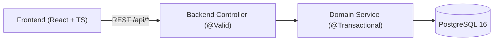
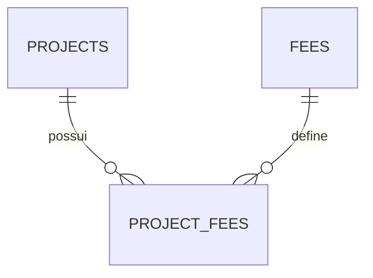

# [RFC] Título da Especificação Arquitetural

- **Autor(es):** Nome(s) do(s) Integrante(s)
- **Data:** YYYY-MM-DD
- **Status:** Rascunho | Em Revisão | Aprovado | Implementado

> **Nota sobre a Política de RFCs ([ADR 0006](../adr/0006-obrigatoriedade-rfc-antes-do-codigo.md)):** O repositório mantém três RFCs gerais consolidadas ([`rfc-backend.md`](rfc-backend.md), [`rfc-frontend.md`](rfc-frontend.md) e [`rfc-po-visao-cliente.md`](rfc-po-visao-cliente.md)). Tarefas individuais de User Stories utilizam diretamente o refinamento descrito nos próprios cards/issues, sem necessidade de criar um arquivo de RFC separado por tarefa. Este modelo serve de referência estrutural para evolução das RFCs gerais do projeto.

---

## 1. Contexto e Motivação

Descreva o problema de negócio e técnico no domínio do **SI600 Sistema de Eventos** (aluguel de estandes, submissão e aprovação de `Planta` em PDF, catálogo e configuração de `Taxa`, cotação de taxas variáveis, acompanhamento de prazos e histórico de auditoria do `Projeto`), utilizando estritamente a linguagem ubíqua definida em [`CONTEXT.md`](../../CONTEXT.md).

---

## 2. Arquitetura, Seams e Módulos

Explicite os módulos profundos (**Deep Modules**) envolvidos, suas **interfaces**, os **seams** de integração e os **adaptadores** utilizados em produção e nos testes de integração:

---

## 3. Modelo de Dados (MER em Mermaid)

Documente as entidades e relacionamentos impactados no esquema relacional:

---

## 4. Contratos de Interface (REST / UI) e Regras de Negócio

Liste os endpoints, payloads de entrada/saída, códigos de status HTTP (`200`, `201`, `400`, `403`, `404`, `409`, `422`) no padrão **RFC 7807 (`ProblemDetail`)** e as invariantes de domínio.

---

## 5. Estratégia de Testes (ADR 0001 e ADR 0002)

Descreva a cobertura nos seams públicos (`@SpringBootTest` + `MockMvc` no backend e Cypress E2E no frontend):
- **Casos Bons (Happy Path):** Fluxo principal com persistência e efeitos colaterais verificados.
- **Casos Ruins (Sad Path):** Conflitos de estado (`409`), violações semânticas (`422`), acesso negado (`403`) e recursos inexistentes (`404`) com garantia de rollback.
- **Casos Incompletos (Boundary & Malformed):** Campos obrigatórios ausentes, formatos inválidos e limites de borda (`400 Bad Request`).
