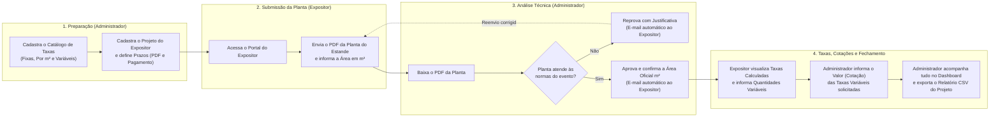
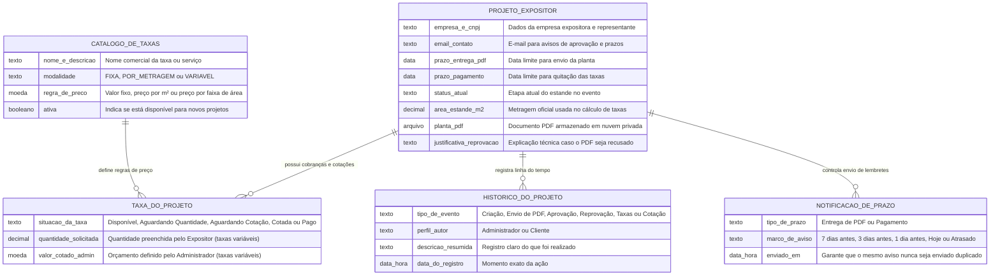

# RFC Executiva (Visão PO & Cliente) — Plataforma SI600 de Gestão de Estandes e Eventos

- **Público-Alvo:** Product Owner (PO), Stakeholders de Negócio, Organização do Evento e Clientes Expositores
- **Data:** 2026-11-08
- **Status:** Implementado / Em Produção

---

## 1. Visão Geral do Produto

A plataforma **SI600 Web Eventos** digitaliza e centraliza todo o relacionamento operacional e financeiro entre a **Organização do Evento (Administrador)** e as **Empresas Expositoras (Clientes)** que alugam e montam estandes na feira.

Antes da plataforma, o recebimento de plantas baixas em PDF, a conferência de metragem ($\text{m}^2$), a cobrança de taxas extras (energia, pontos de água, limpeza, credenciais) e a cobrança de prazos ocorriam de forma fragmentada por e-mail e planilhas manuais. O sistema elimina esse gargalo garantindo:
1. **Rastreabilidade de ponta a ponta:** Toda ação (cadastro, envio de planta, aprovação, reprovação, escolha de quantidades e cotação de valores) fica registrada em uma linha do tempo auditável.
2. **Cálculo automático e transparente:** Taxas fixas e por metragem são calculadas automaticamente a partir da área oficial aprovada do estande, evitando erros manuais de cobrança.
3. **Acompanhamento proativo de prazos:** Tags visuais de alerta e avisos automáticos por e-mail notificam expositores e administradores antes e depois do vencimento de prazos críticos.

---

## 2. Como o Sistema Funciona na Prática (Jornadas de Uso)

### 2.1 O que o Administrador faz no sistema?
- **Catálogo de Taxas:** Cria e mantém a tabela oficial de preços do evento. O sistema suporta três formas de cobrança:
  - **Taxa Fixa:** Valor único para qualquer estande (ex: Taxa de Inscrição ou Limpeza Básica).
  - **Taxa por Metragem ($\text{m}^2$):** Calculada automaticamente pelo tamanho do estande, podendo ser um valor direto por $\text{m}^2$ (ex: $\text{R\$ } 50,00/\text{m}^2$) ou por blocos de área (ex: 1 extintor a cada $15\text{ m}^2$).
  - **Taxa Variável (Sob Demanda):** Serviços em que o expositor informa quanto precisa (ex: kVA de energia extra, pontos de água) e o Administrador informa o orçamento (cotação) correspondente.
- **Gestão de Projetos e Configuração de Taxas:** Cadastra cada empresa expositora (CNPJ/CPF, responsável, categoria, e-mail e prazos de entrega do PDF e de pagamento) e escolhe quais taxas do catálogo se aplicam àquele estande.
- **Análise de Plantas (Aprovação ou Reprovação):** Analisa o PDF enviado pelo expositor. Se estiver correto, aprova confirmando a metragem oficial do estande. Se houver pendências técnicas, reprova informando o motivo obrigatório — e o expositor recebe imediatamente um e-mail explicativo para enviar uma nova versão.
- **Fila de Cotações:** Visualiza em uma única tela todos os pedidos de itens variáveis enviados pelos expositores e preenche o valor final cotado.
- **Dashboard Gerencial (Kanban) e Exportação de Planilha (CSV):**
  - No **Dashboard**, visualiza os projetos divididos por etapa (`Aguardando PDF`, `PDF em Análise`, `Reprovado`, `Aprovado`, `Aguardando Pagamento`, `Concluído`), além de painéis de alerta rápido para **Aprovações Pendentes**, **Cotações Pendentes** e **Expositores Inativos** (clientes que não acessam a plataforma há 7 dias ou mais).
  - Em qualquer projeto, pode baixar com um clique a **Planilha CSV** contendo todos os dados cadastrais, status e o detalhamento financeiro completo das taxas do expositor.

### 2.2 O que o Expositor (Cliente) faz no sistema?
- **Envio da Planta do Estande:** Faz o upload do projeto arquitetônico em PDF (até 10 MB) e informa a metragem do estande. Caso a planta seja reprovada, lê a justificativa diretamente na tela (e no seu e-mail) e pode reenviar o PDF corrigido quantas vezes forem necessárias.
- **Consulta de Taxas e Solicitação de Itens Variáveis:** Assim que a planta é aprovada, a tabela financeira do estande é liberada. O expositor vê o valor já calculado das taxas fixas e por metragem, e preenche a quantidade desejada nas taxas variáveis clicando em **Salvar**.
- **Linha do Tempo Transparente:** Acompanha o histórico completo de tudo o que aconteceu no seu projeto (datas de criação, envios de planta, decisões da administração e atualizações de taxas).

---

## 3. Inteligência de Prazos e Alertas Automáticos

Para evitar atrasos na montagem do evento, o sistema monitora continuamente dois prazos de cada projeto: o **Prazo de Entrega da Planta (PDF)** e o **Prazo de Pagamento**:

1. **Etiquetas Visuais Inteligentes (Tags de Alerta):**
   - **Atrasado:** O prazo de entrega do PDF ou de pagamento já venceu.
   - **Prazo Próximo:** Faltam 7 dias ou menos para o vencimento do prazo atual.
   - **Pendente:** O projeto ainda aguarda aprovação da planta ou conclusão das taxas.
   - **Em Dia / Concluído:** Tudo dentro do cronograma ou inteiramente finalizado.
2. **Régua Automática de E-mails:**
   - O sistema envia lembretes automáticos para o expositor **7 dias antes**, **3 dias antes**, **1 dia antes** e **no dia do vencimento** do prazo.
   - Se o prazo vencer sem conclusão (**1 dia de atraso**), tanto o expositor quanto a administração do evento recebem um aviso de atraso.

---

## 4. Estrutura de Informações do Sistema (MER Simplificado)

O diagrama abaixo representa como as informações do evento estão organizadas e conectadas de forma segura no banco de dados:

---

## 5. Segurança, Confiabilidade e Qualidade

- **Armazenamento Seguro das Plantas PDF:** Os arquivos PDF das plantas não ficam expostos publicamente; são guardados em nuvem criptografada (Backblaze B2) e acessados apenas por links temporários que expiram em 15 minutos.
- **Proteção contra Alterações Indevidas:**
  - O expositor só visualiza valores de cobrança depois que sua planta foi tecnicamente aprovada.
  - Uma planta que já possua pagamentos gerados não pode ser revertida para reprovada, protegendo a consistência financeira do evento.
  - Cada expositor acessa exclusivamente os dados e documentos do seu próprio estande.
- **Validação Automatizada Contínua:** Todas as jornadas (do cadastro do projeto até a cotação de taxas, dashboard e exportação de planilhas) passam por baterias automatizadas de testes integrados a cada atualização do sistema.
